# 12주차 사용자 교차 테스트 피드백 반영 리포트 (FEEDBACK_LOG)

> **대상 앱**: BIRDS SaaS 비용 누수 & 중복 구독 진단 대시보드 (https://birds-stackfit.streamlit.app/)  
> **요약**: 타 팀 교차 테스트 피드백 총 10건 중 **8건 반영(버그 2건, 사용성 6건)**, **2건 미반영(보류 1건, 백로그 1건)**

---

## 1. 반영한 피드백 (총 8건 — 전후 비교 및 커밋 해시)

### [피드백 1 / 버그] 사이드바 부서명 표기 불일치로 합산 누락 (담당: 박지우)
- **① 받은 피드백 원문 (최영효)**:
  > 버그: 사이드바 '부서 선택' 목록에 같은 부서가 다른 이름으로 따로 나옵니다(Data/데이터, HR/인사/인사팀, Sales/영업, 경영지원/경영지원팀, 기획/기획팀). 그래서 HR을 선택하면 '인사', '인사팀'으로 들어간 결제 내역이 빠지고 Microsoft 365 한 건(57,600원)만 집계되어, 인사 부서 전체 비용을 볼 수 없습니다. 서비스명처럼 부서명도 하나로 합쳐서 보여 주면 좋겠습니다. 재현: test_normal.csv 업로드 → 사이드바 '부서 선택' → HR 선택
- **② 수정 전 화면 캡처 및 동작 설명**:  
  부서 목록에 `HR`·`인사`·`인사팀`, `Data`·`데이터` 등이 따로 노출되어 `"HR"` 선택 시 57,600원만 집계되는 등 같은 부서 결제가 나뉘어 합산됨.  
  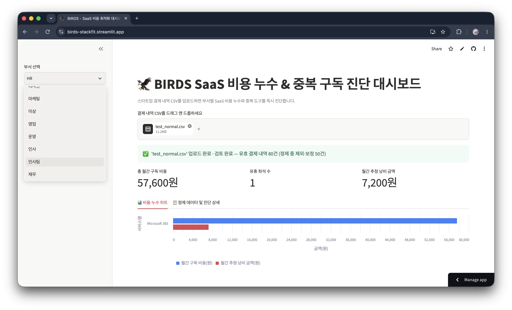
- **③ 수정 내용과 근거**:  
  `core/data_processing.py`의 `clean_billing_csv()`에 `normalize_department()`를 추가해 **앞뒤 공백 제거 → `'~팀'` 접미사 제거 → 영문 별칭(`HR`/`Data`/`Sales`) 한글 표준명 매핑**을 적용하고, 통일·합산 검증 단위 테스트 2건을 추가함.
- **④ 수정 후 화면 캡처**:  
  부서 목록에서 중복 표기가 사라지고 `"인사"` 하나로 통합되어 선택 시 465,600원으로 정상 합산됨.  
  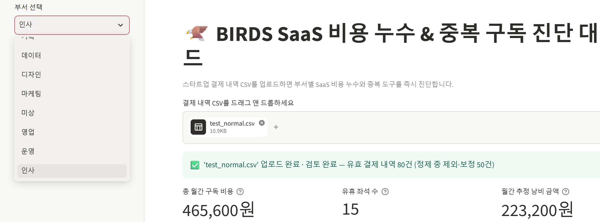
- **⑤ 수정 커밋 해시**: `b08487e` (캡처 추가: `9eb6b48`)

---

### [피드백 3 / 버그] CSV 파일 교체 시 이전 분석 결과·필터 잔존 (담당: 차세연)
- **① 받은 피드백 원문 (이혜원)**:
  > 버그: csv 파일을 다른 것으로 교체했을 때, 결과가 즉시 갱신되지 않고 이전 분석 결과가 뜹니다. 왼쪽 사이드바의 옵션은 '전체', '전체'로 초기화되는데, 분석 창에는 이전 결과가 떠 있어서, 사이드바의 옵션을 다시 선택한 후에야 교체된 파일의 분석 결과가 확인되는 것 같습니다.
- **② 수정 전 화면 캡처 및 동작 설명**:  
  `"인사"` 필터 선택 후 파일을 교체하면 사이드바는 `"전체"`로 보이는데, KPI는 `0원 / 유휴 좌석 5`, 차트는 Dropbox 1개 등 이전 필터·결과가 잔존함.  
  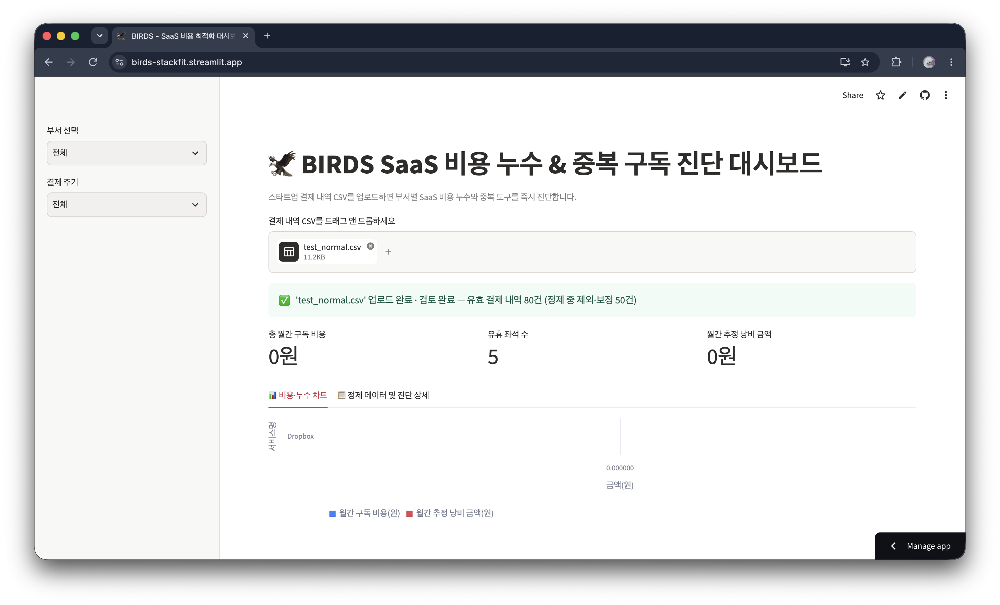
- **③ 수정 내용과 근거**:  
  `app.py`에서 새 파일(`uploaded.file_id` 변경)을 감지하면 사이드바 위젯 생성 전에 `reset_upload_state()`를 호출해 `audit_result`, `uploaded_file_id`, `dept_filter`, `cycle_filter`를 선행 리셋하도록 수정하여 교체 즉시 새 파일 기준으로 렌더링되게 함.
- **④ 수정 후 화면 캡처**:  
  파일 교체 직후 필터가 `"전체/전체"`로 리셋되고 새 파일 기준(`28,747,450원 / 488 / 12,424,935원`)으로 즉시 갱신됨.  
  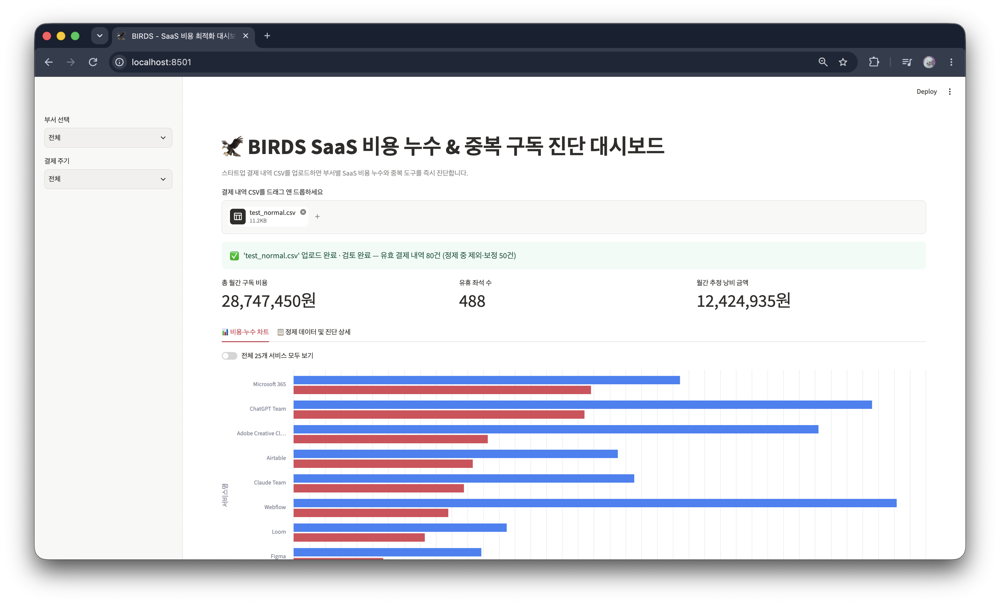
- **⑤ 수정 커밋 해시**: `851fa62`

---

### [피드백 4 / 사용성] 업로드 전 CSV 필수 열 9종 목록 및 템플릿 안내 부재 (담당: 차세연)
- **① 받은 피드백 원문 (오채윤)**:
  > 사용성: 필수 열이 빠진 파일을 올리면 "필수 열 누락: billing_amount_krw"처럼 빠진 열 이름만 나옵니다. 첫 화면에도 CSV에 어떤 열이 필요한지 안내나 샘플 파일이 없어서, 처음 쓰는 사람은 업로드해 보고 나서야 형식을 알게 됩니다. 업로드 전에 필수 열 목록을 알려 주면 좋겠습니다.
- **② 수정 전 화면 캡처 및 동작 설명**:  
  업로드 전 초기 화면에 안내 문구 한 줄만 표시되어 사용자가 필요한 열 구조와 형식을 사전에 알 수 없었음.  
  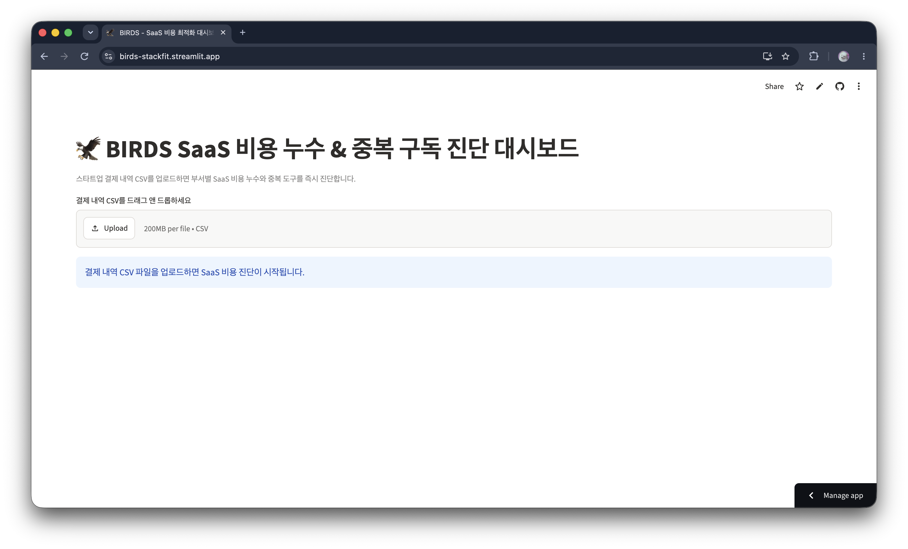
- **③ 수정 내용과 근거**:  
  실제 정제 기준인 `CLEAN_REQUIRED_COLUMNS`를 단일 기준으로 삼아 `backend.get_required_columns_guide()`와 `backend.get_template_csv_bytes()`를 구현하고, 업로드 전 화면(`uploaded is None`)에 **필수 열 9종 안내 표(열 이름·설명·예시), 인코딩 안내, 템플릿 CSV 다운로드 버튼**을 추가함. 예시 개인정보는 보안 원칙에 따라 가상 값만 사용.
- **④ 수정 후 화면 캡처**:  
  첫 화면에서 필수 열 9종 표와 템플릿 CSV 다운로드 버튼을 바로 확인 가능함.  
  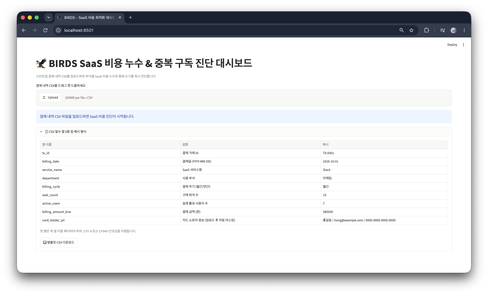
- **⑤ 수정 커밋 해시**: `1c0a3f7`

---

### [피드백 5 / 사용성] '전체 결제 내역' 표의 영어 컬럼명 노출 (담당: 김서연)
- **① 받은 피드백 원문 (김리나)**:
  > 1. 정제 데이터 및 진단 상세 > 전체 결제 내역 하단 표에서 CSV 파일의 컬럼명을 그대로 쓰지 않고 더 직관적으로 알 수 있는 컬럼명으로 표시하면 좋겠습니다.
- **② 수정 전 화면 캡처 및 동작 설명**:  
  표의 컬럼명이 원본 영문 스키마(`tx_id`, `billing_date`, `monthly_cost_krw` 등) 그대로 표시되어 일반 사용자가 의미를 즉시 파악하기 어려움.  
  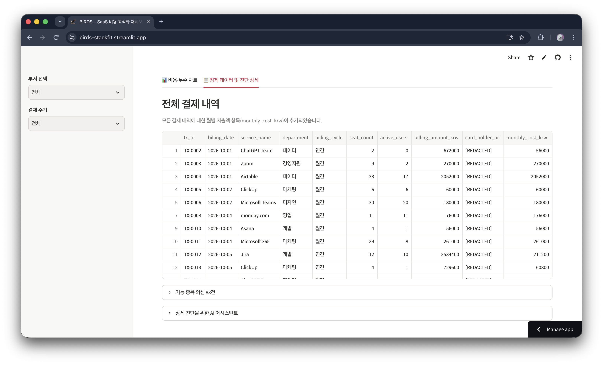
- **③ 수정 내용과 근거**:  
  UI-백엔드 분리 원칙을 지켜 `backend.py`에 `rename_columns_for_display(df)` 함수를 추가하고, `app.py`의 `st.dataframe` 출력 직전에 호출하여 10개 컬럼명을 모두 직관적인 한글 명칭으로 변환해 표시함.
- **④ 수정 후 화면 캡처**:  
  `전체 결제 내역` 표의 모든 컬럼명이 한글(`결제 거래 ID`, `결제일`, `월간 구독 비용(원)` 등)로 표시됨.  
  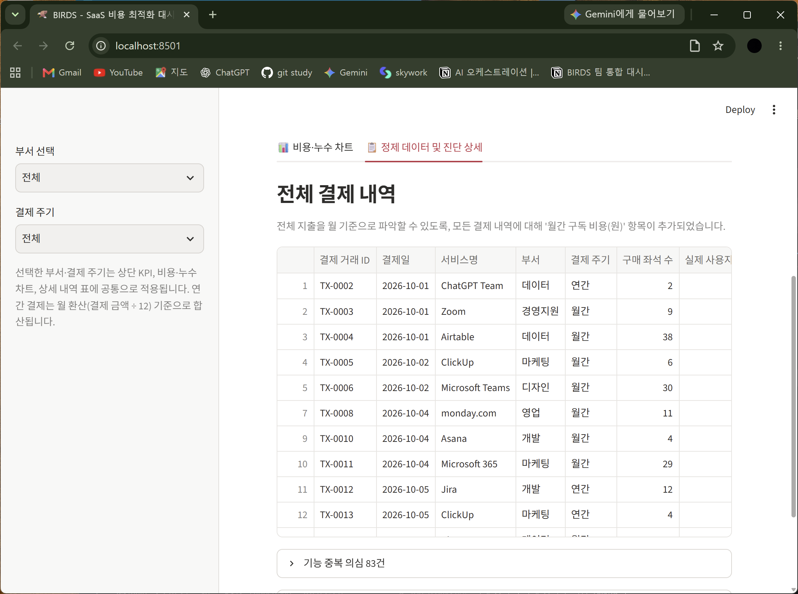
- **⑤ 수정 커밋 해시**: `1401315`

---

### [피드백 6 / 사용성] 월간 추정 낭비 금액 산출 기준 설명 부재 (담당: 박지우)
- **① 받은 피드백 원문 (김리나)**:
  > 2. 부서 HR을 선택했을 때 구독하는 서비스가 Microsoft 365 하나밖에 없는데 월간 추정 낭비 금액이 7,200원이라고 나옵니다. 알 수 있는 정보는 기능 중복 의심밖에 없는데 이 정보가 0건이라 어떠한 기준으로 낭비이고 비용이 책정됐는지 모르겠습니다. 낭비 금액 관련해서 책정 기준을 알려주면 좋을 것 같아요.
- **② 수정 전 화면 캡처 및 동작 설명**:  
  상단 KPI에 도움말이 없어 중복 구독이 0건인데도 낭비 금액이 표시되는 산출 근거를 사용자가 알 수 없었음.  
  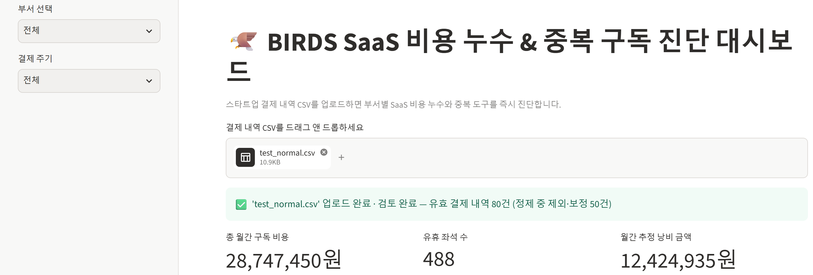
- **③ 수정 내용과 근거**:  
  `app.py`의 `월간 추정 낭비 금액` `st.metric(..., help=...)`에 실제 계산식과 함께 **"중복 구독과는 별개로 유휴 좌석 기준으로 계산되므로, 중복이 0건이어도 유휴 좌석이 있으면 금액이 표시됩니다."**라는 설명을 명시함.
- **④ 수정 후 화면 캡처**:  
  도움말 아이콘에서 산출식과 중복 구독과의 차이 설명을 바로 확인 가능함.  
  
- **⑤ 수정 커밋 해시**: `9d70d8f`

---

### [피드백 7 / 사용성] '유휴 좌석 수' 용어 의미 불명확 (담당: 박지우)
- **① 받은 피드백 원문 (임채희 · 이혜원)**:
  > (임채희) 사용성: 유휴 좌석 수가 어떤 것을 의미하는 것인지 잘 모르겠습니다. 의미하는 바를 추가로 명시해 주시면 사용자가 앱을 사용하는 데에 있어서 더 편리해질 것 같습니다.  
  > (이혜원) 사용성: 결과 화면의 '유휴 좌석 수'가 어떤 의미인지 잘 모르겠습니다.
- **② 수정 전 화면 캡처 및 동작 설명**:  
  KPI 카드에 용어 설명이 없어 비전문가가 `유휴 좌석 수`의 뜻을 직관적으로 알기 어려웠음.  
  
- **③ 수정 내용과 근거**:  
  `app.py`의 `유휴 좌석 수` `st.metric(..., help=...)`에 **"구매했지만 실제로 쓰지 않는 좌석 수"**라는 정의와 `구매 좌석 수 − 활성 사용자 수` 산출 방식을 추가함.
- **④ 수정 후 화면 캡처**:  
  도움말 아이콘에 마우스를 올리면 용어 정의와 계산 방식이 즉시 표시됨.  
  
- **⑤ 수정 커밋 해시**: `2ebe5d8`

---

### [피드백 8 / 사용성] 비용·누수 차트 상위 10개 노출 및 정렬 기준 미명시 (담당: 김서연)
- **① 받은 피드백 원문 (이혜원)**:
  > 사용성: 결과 화면의 '비용,누수 차트' 창에서는 일단 일부 서비스가 보이고, '전체 ~개 서비스 모두 보기' 버튼을 누르면 그때 모든 서비스에 대한 결과가 보이는 것 같은데요. 초기에 보이는 일부 서비스가 어떠한 기준으로 선택된 건지 함께 명시해 주면 좋을 것 같습니다. 구독 비용 대비 추정 낭비 금액이 많은 순서라던지요.
- **② 수정 전 화면 캡처 및 동작 설명**:  
  차트에 정렬 기준 안내와 상위 10개 기본 노출 설명이 없어 초기 표시 서비스의 선정 기준을 사용자가 알 수 없었음.  
  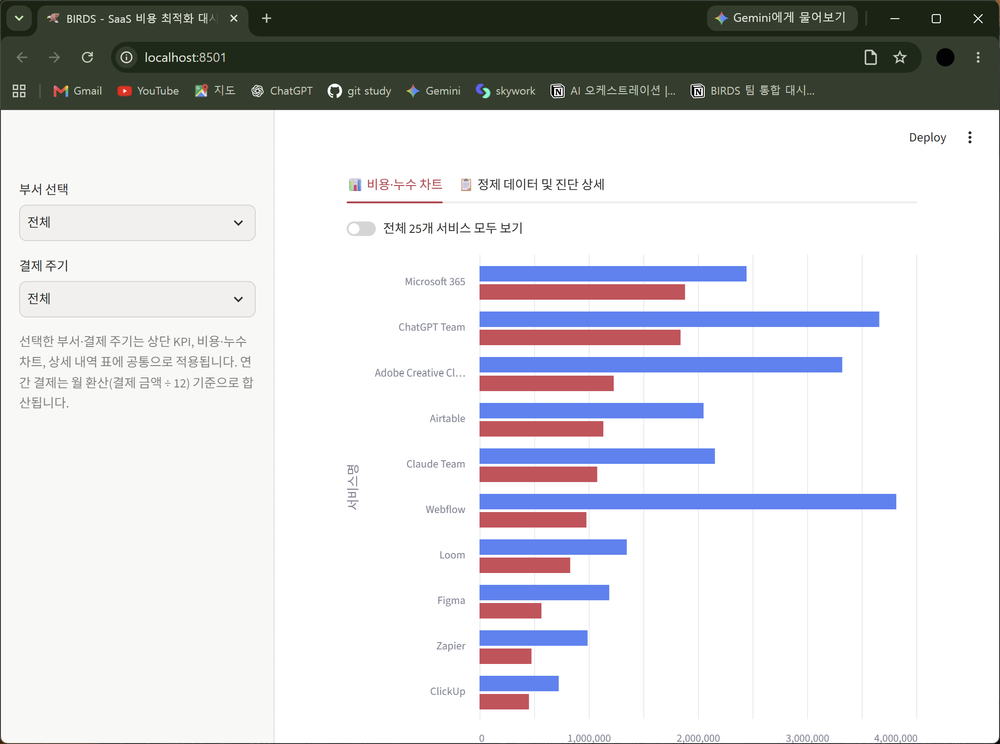
- **③ 수정 내용과 근거**:  
  차트 상단에 `st.caption`으로 **월간 추정 낭비 금액 내림차순 정렬 및 총 비용·낭비 금액 비교 기준**을 명시하고, 10개 초과 시 표시되는 `st.toggle`에 `help`로 상위 10개 기본 노출 안내를 추가함.
- **④ 수정 후 화면 캡처**:  
  차트 상단 정렬 기준 문구와 토글 도움말이 함께 제공됨.  
  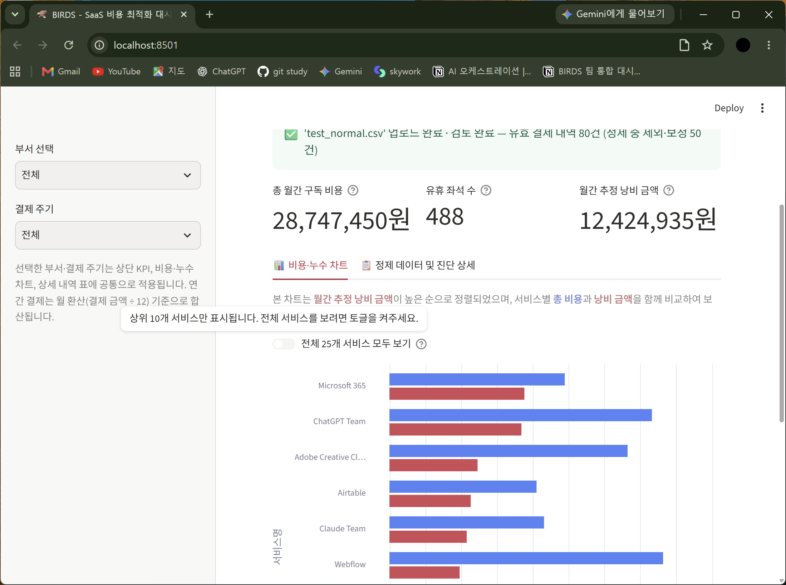
- **⑤ 수정 커밋 해시**: `b3af96a`

---

### [피드백 9 / 사용성] 사이드바 '결제 주기' 의미 및 환산 방식 불명확 (담당: 박지우)
- **① 받은 피드백 원문 (이혜원)**:
  > 사용성: 왼쪽 사이드바의 '결제 주기'와 그에 따른 결과의 정확한 의미를 잘 모르겠습니다. 결제 주기가 1년 단위인 서비스, 한 달 단위인 서비스에 대한 것이라고 생각하면 될까요?
- **② 수정 전 화면 캡처 및 동작 설명**:  
  사이드바 `결제 주기` 필터에 설명이 없어 월간/연간의 뜻과 집계 시 환산 기준을 확인하기 어려웠음.  
  
- **③ 수정 내용과 근거**:  
  사이드바 `결제 주기` `st.sidebar.selectbox(..., help=...)`에 월간/연간 결제의 의미와 **연간 결제는 결제 금액 ÷ 12로 월 환산**해 집계한다는 안내를 추가함.
- **④ 수정 후 화면 캡처**:  
  결제 주기 옆 도움말 아이콘에서 과금 단위 의미와 월 환산 기준을 확인 가능함.  
  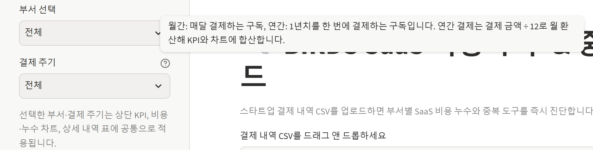
- **⑤ 수정 커밋 해시**: `3500d12`

---

## 2. 미반영 피드백 분류 및 사유 (총 2건)

| 번호 | 작성자 | 받은 피드백 요지 | 분류 | 미반영(보류/백로그) 사유 |
| :---: | :---: | :--- | :---: | :--- |
| **2** | 오채윤 | 사이드바 `'결제 주기'`를 월간으로 선택 시 표에는 행이 있는데 차트 데이터가 없다고 표시됨 | **보류** | 모든 부서×결제 주기 조합을 전수 점검한 결과 표에 행이 있는데 차트만 비는 버그는 재현되지 않음. 부서명이 미통일된 상태에서 `HR`(연간 1건)과 `인사`/`인사팀`(월간)이 분리돼 발생한 혼동으로, 피드백 1(부서명 통일) 수정으로 근본 해소됨. |
| **10** | 임채희 | 기능 중복 의심 시 어떤 서비스를 구독 유지/해지할지 간단한 추천 해결 방법 제시 | **백로그** | 12주차는 Mock LLM 기반 상태 관리·UI 흐름 완성 범위이며, 구독 유지/해지 추천 리포트는 13주차 실제 Claude API 연동 스프린트에서 구현 예정. |