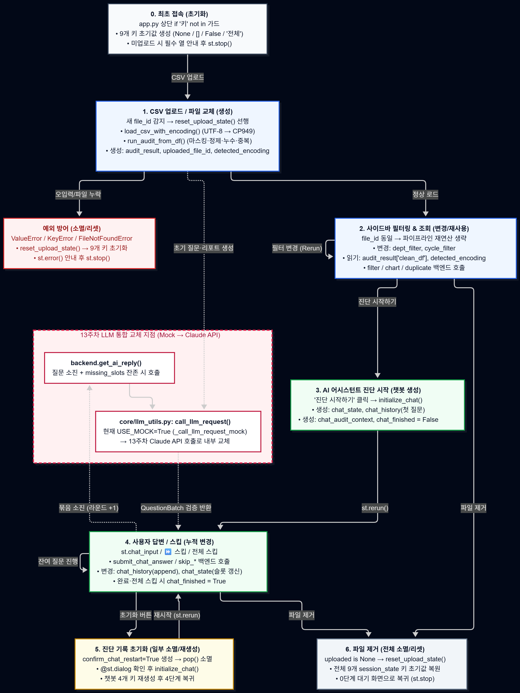

# 🦅 BIRDS: 스타트업 업무 프로세스 기반 SaaS 정밀 감사 및 추천 AI 솔루션

> **AI 오케스트레이션 스튜디오 — 12주차 MVP 공식 배포 · 상태 관리 심화 · 교차 테스트 피드백 반영**

* **공식 배포 URL (Streamlit Community Cloud)**: [https://birds-stackfit.streamlit.app/](https://birds-stackfit.streamlit.app/)
* **핵심 검증 가설 (Lean Startup MVP)**:
  > *"우리 앱은 **[중소 스타트업 경영지원·운영 담당자]**가 **[부서별 법인카드 SaaS 구독의 유휴 좌석 누수와 중복 결제를 파악하지 못하는 문제]**를 겪을 때, **[결제 CSV 정량 감사 대시보드와 업무 맥락 기반 AI 역질문]**으로 **[월간 낭비 비용을 즉시 식별하고 도구 최적화 근거를 확보하는 가치]**를 얻을 수 있다는 가설을 검증한다."*

---

## 1. 앱 실행 방법 및 12주차 핵심 아키텍처

### 1-1. 로컬 실행 방법
```bash
# 1. 의존성 패키지 설치
pip install -r requirements.txt

# 2. Streamlit 대시보드 실행
streamlit run app.py

# 3. 단위·통합 테스트 실행 (56 passed, 1 skipped)
pytest
```

### 1-2. UI-백엔드 완전 분리 및 상태 관리 (`st.session_state`)
* **계층 분리**: `app.py`에는 `pandas` 직접 가공 코드가 없으며, 모든 파일 로드·정제·필터링·KPI·차트·챗봇 상태 갱신은 파사드 모듈인 [`backend.py`](./backend.py)를 거쳐 [`core/`](./core/) 핵심 엔진에 위임합니다.
* **상태 관리 및 13주차 LLM 교체 설계**: 총 10개의 `st.session_state` 키(`audit_result`, `uploaded_file_id`, `detected_encoding`, `dept_filter`, `cycle_filter`, `chat_state`, `chat_history`, `chat_finished`, `chat_audit_context`, `confirm_chat_restart`)로 Rerun 시 재연산 방지, 파일 교체 시 상태 초기화, Mock LLM 챗봇 대화 누적을 구현했습니다.
* **상세 키 정리 표 및 데이터 흐름 구조도**: [`docs/session_state_design.md`](./docs/session_state_design.md) / [`docs/state_flow_diagram.png`](./docs/state_flow_diagram.png)



### 1-3. 방어적 UX 적용 현황 (오입력 대응)
1. **업로드 전 가이드 및 중단(`st.info` + `st.stop`)**: 미업로드 시 필수 열 9종 안내 표와 가상 템플릿 CSV 다운로드 버튼을 표시하고 실행을 대기합니다.
2. **한글 인코딩 자동 복구(`st.warning`)**: UTF-8 실패 시 `seek(0)` 후 CP949로 재시도하며, CP949로 읽은 경우 Rerun 이후에도 경고 배너를 유지합니다.
3. **손상·필수 열 누락 CSV 방어(`st.error` + `st.stop`)**: 빈 파일, 파싱 오류, 필수 컬럼 누락(`ValueError`/`KeyError`), 카탈로그 누락(`FileNotFoundError`) 시 상태를 초기화하고 원인 안내 후 안전하게 중단합니다.

---

## 2. 12주차 과제 산출물 및 팀원별 기여 내역

* **교차 테스트 피드백 반영 리포트 (전후 비교·미반영 사유)**: [`FEEDBACK_LOG.md`](./FEEDBACK_LOG.md)
* **`st.session_state` 키 정리 표 및 데이터 흐름 구조도**: [`docs/session_state_design.md`](./docs/session_state_design.md), [`docs/state_flow_diagram.png`](./docs/state_flow_diagram.png)
* **대시보드 메인 UI / 백엔드 파사드**: [`app.py`](./app.py), [`backend.py`](./backend.py)
* **핵심 엔진 모듈 (`core/`)**: [`data_processing.py`](./core/data_processing.py), [`quant_analysis.py`](./core/quant_analysis.py), [`llm_utils.py`](./core/llm_utils.py), [`pipeline.py`](./core/pipeline.py), [`schema.py`](./core/schema.py), [`template.py`](./core/template.py)
* **AI 통제·과정 기록 아카이브**: [`ai_log/`](./ai_log/) ([강규민](./ai_log/gyumin_log.md), [차세연](./ai_log/chaseyeon_log.md), [박지우](./ai_log/jiwoo_log.md), [김서연](./ai_log/seoyeon_log.md), [장형욱](./ai_log/hyungwuk_log.md))
* **통합 보안 점검표 (5~12주차)**: [`security_checklist.md`](./security_checklist.md)
* **팀 표준 스키마 및 프로세스·Slot 정의서**: [`docs/schema.md`](./docs/schema.md), [`data/slot_schema.json`](./data/slot_schema.json)
* **테스트 및 검증 기록**: [`tests/`](./tests/), [`docs/pytest_result.log`](./docs/pytest_result.log), [`result_captures/`](./result_captures/)

| 담당자 | 10~11주차 핵심 역할 | 12주차 피드백 반영 · 상태 관리 · 배포 기여 |
| :--- | :--- | :--- |
| **강규민** | `pipeline.py` 통합, `backend.py` 파사드·상태 초기화 골격 | 피드백 3단계 분류·가설 정의, `session_state` 키 표·구조도 제작, `README.md` 통합 및 최종 제출 |
| **차세연** | `docs/schema.md` 정립, 업로더·인코딩·오입력 방어 | `requirements.txt` 정리, 파일 교체 상태 리셋, 필수 열 9종 표·템플릿 다운로드, CP949 경고 및 테스트 추가, 피드백 2번 교차 검증 |
| **박지우** | `clean_billing_csv` 정제 모듈, 사이드바 필터·KPI | 부서명 표기 통일(`normalize_department`), KPI·결제 주기 `help` 툴팁 용어·산출 기준 보강, 10주차 3조 코드 리뷰 보완, `FEEDBACK_LOG.md` 작성 |
| **김서연** | `llm_utils.py` Mock LLM·검증, 차트·상세 표 UI | 차트 정렬 기준 안내, 표 한글 컬럼명 매핑, 패턴 ③ Mock 챗봇 UI·백엔드 상태 연동 및 Mock 질문 8종 확장 |
| **장형욱** | `quant_analysis.py`, 통합 테스트·보안 점검 | 배포 URL 정상/오입력 실테스트 및 12주차 배포 보안 감사(`security_checklist.md` 갱신) |

---

## 3. 프로젝트 배경 및 이전 주차 아카이브

### 3-1. 기존 ERP 대비 BIRDS 차별화
| 비교 기준 | 기존 중소·중견 ERP (더존 WEHAGO, SAP B1 등) | BIRDS (SaaS 정밀 감사 & 프로세스 기반 추천 AI) |
| :--- | :--- | :--- |
| **핵심 목적** | 세금계산서, 전표, 급여 등 **법적·재무적 사후 기록(System of Record)** | 실제 업무 워크플로우 기반 **SaaS 비용 누수 탐지 및 최적화(System of Intelligence)** |
| **데이터 처리 수준** | 법인카드 결제 총액을 `지급수수료(소프트웨어)` 계정 하나로 사후 집계 | 별칭(Alias)을 카탈로그와 매칭해 **결제 좌석(`seat_count`) 대비 실사용자(`active_users`) 누수액** 정밀 산출 |
| **업무 맥락 파악** | 해당 SaaS가 어떤 업무 프로세스에 쓰이는지 파악 불가 | **5대 업무 프로세스(P1~P5)** 및 **결측 변수(Slot)** 설계도를 기반으로 LLM이 도입 맥락 역질문 |
| **관계 정의** | 코어 재무·인사 인프라 | ERP가 보지 못하는 SaaS 운영 사각지대를 보완하고 ERP 모듈과 버티컬 SaaS의 중복까지 진단 |

### 3-2. 10주차 교차 코드 리뷰 반영 내역
| 번호 | 리뷰 대상 모듈 | 수신한 리뷰 코멘트 요지 | 수용/보류 판단 및 사유 | 반영 내역 및 관련 커밋 |
| :---: | :--- | :--- | :--- | :--- |
| 1 | `core/quant_analysis.py` | 1) `detect_duplicate_tags` 반환 스키마·docstring 불일치, 2) 카탈로그 태그 순서 유실, 3) 3중 중첩 완화 | **부분 수용 (1·3번 수용, 2번 보류)** — `DuplicatePair` TypedDict·docstring을 실제 반환 구조(`dict`/`set`)와 일치시키고 `itertools.combinations` 및 `_extract_string_list` 헬퍼로 중첩 완화. 2번은 하위 모듈(`pipeline.py`, `backend.py`) 및 기존 테스트의 `set` 계약 호환을 위해 보류. | 커밋 해시: `000cff9` |

### 3-3. 이전 주차 아카이브 문서
* **9~10주차 프롬프트 원문 및 결함 수정 로그**: [`docs/prompt_log.md`](./docs/prompt_log.md)
* **팀원별 구현 함수 및 체크리스트**: [`docs/assignment_checklist.md`](./docs/assignment_checklist.md)
* **역질문 프롬프트 템플릿 초안**: [`prompts/question_template.md`](./prompts/question_template.md)