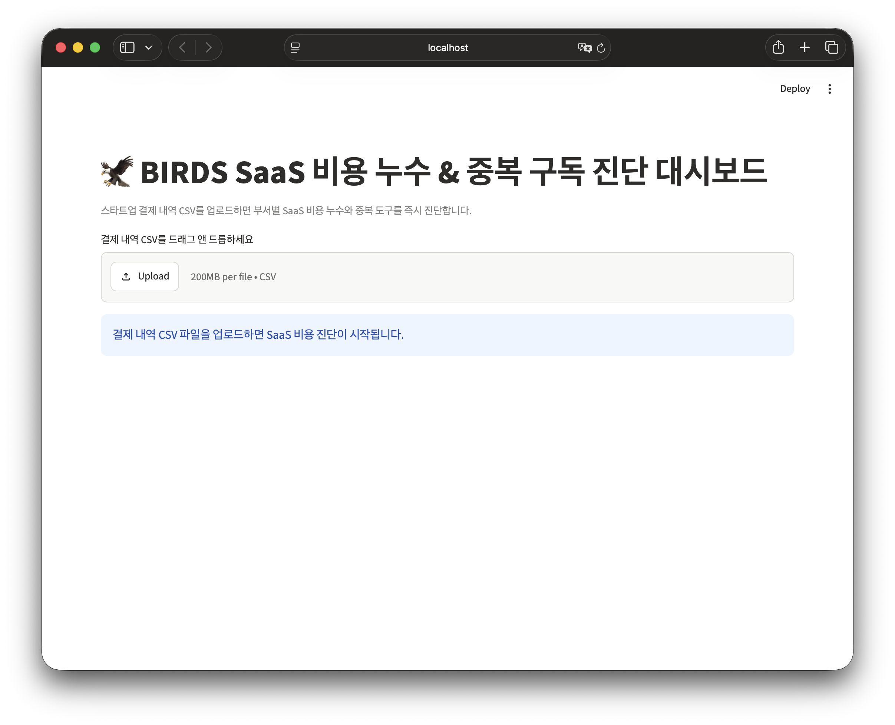
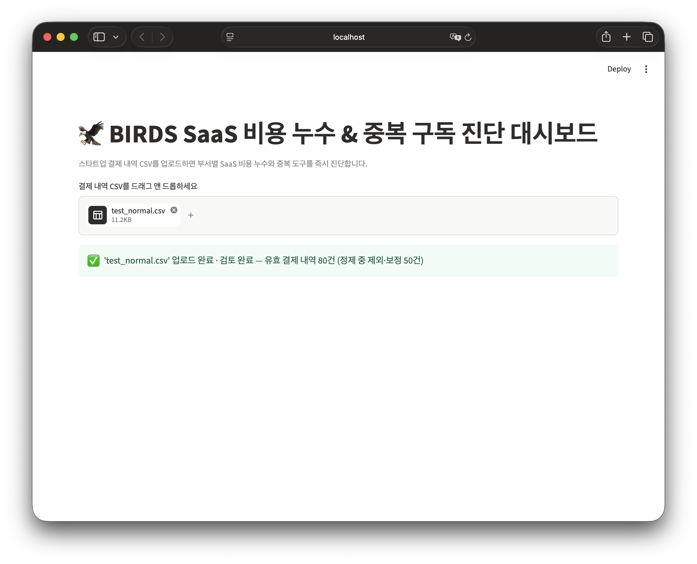
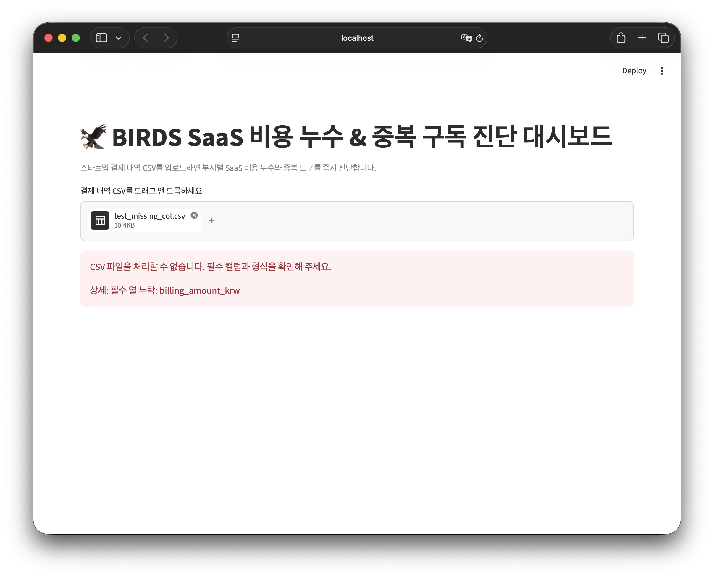

## [2026-11-08] load_billing_csv() 리팩터링 (담당: 차세연)
- **대상 모듈**: data_processing.py / **관련 커밋**: ac64aef -> fb16d6f
- **초기 프롬프트(요지)**: load_billing_csv() 함수에 Args:, Returns:, Raises:가 포함된 docstring을 작성하라. 다른 함수는 절대 건들지 않는다. 함수에 파일이 없거나 깨졌을 때 None을 반환하며 에러를 삼키는 코드가 있다면 즉시 FileNotFoundError나 ValueError를 raise하도록 수정하라.
- **AI 생성 결과(요지)**: `load_billing_csv()`에 Args/Returns/Raises를 갖춘 docstring을 추가함. `except FileNotFoundError: raise`를 추가함.
- **발견한 문제(취약점·오류·품질)**: 계약 위반이나 동작 변경은 발견되지 않음. 품질상 `except FileNotFoundError: raise`는 `FileNotFoundError`가 이미 그대로 전파되므로 동작상 불필요한 구문이라고 판단함.
- **수정 보완 내역**: 불필요한 `except FileNotFoundError: raise`를 제거함.
- **검증 및 판단 메모**: `pytest -k "billing" -vv test_data_processing.py` 결과 4/4 PASSED 확인. `FileNotFoundError`는 docstring의 Raises와 단위 테스트로 계약을 보장하므로 코드상 명시적 `raise`는 불필요하다고 판단함.

## [2026-11-08] load_saas_catalog() 리팩터링 (담당: 차세연)
- **대상 모듈**: data_processing.py / **관련 커밋**: fb16d6f -> 12f4f63
- **초기 프롬프트(요지)**: 매직 값 상수화를 적용하도록 요청함. 인코딩 문자열(`"utf-8-sig"`), 최상위 필수 키(`"meta"`, `"tools"`), 도구별 필수 키를 각각 모듈 상단 상수(`CATALOG_ENCODING`, `CATALOG_REQUIRED_KEYS`, `TOOL_REQUIRED_KEYS`)로 분리하되 키의 순서와 값은 기존과 동일하게 유지하도록 지시함. 또한 다른 함수는 절대 건들지 않을 것을 명시함.
- **AI 생성 결과(요지)**: 요청한 상수 3종(`CATALOG_ENCODING`, `CATALOG_REQUIRED_KEYS`, `TOOL_REQUIRED_KEYS`)을 모듈 상단에 분리하고 함수 내부 참조를 상수로 교체함. 키 순서, 예외 메시지, 검증 순서, 시그니처는 원본과 동일하게 유지됨.
- **발견한 문제(취약점·오류·품질)**: 계약 위반이나 동작 변경은 발견되지 않음. 품질상 아쉬운 점으로 1. `CSV_ENCODING`과 `CATALOG_ENCODING`의 값 중복, 2. `tools[i]`가 dict가 아닐 때 "필수 키 누락: tool_id"로 출력되는 부정확한 메시지를 발견함.
- **수정 보완 내역**: 상수화 결과는 그대로 채택. 인코딩 상수는 형식별 독립 변경 가능성을 고려해 분리 유지. 2의 부정확한 메시지는 수정해 이후 `fix:`로 커밋함.
- **검증 및 판단 메모**: `pytest -k "catalog" -vv test_data_processing.py` 결과 12/12 PASSED 확인. 금지 사항을 명시한 제약형 프롬프트로 계약이 유지됨을 확인함.

---

## [2026-11-15] run_audit_from_df() 통합 결함 4건 수정: 튜플 언패킹·￦ 정제·로더 예외·카탈로그 경로 (담당: 차세연)
- **대상 모듈**: backend.py, data_processing.py / **관련 커밋**: 4c39158 -> cabee83, 3dc7b29, 05c7ee8, 6098156
- **초기 프롬프트(요지)**: B1(업로더) 작업 전에 이전에 실제 실행으로 직접 발견한 문제 목록(튜플 반환, ￦ 미처리, 로더 예외 누락, 카탈로그 파일 부재 처리)을 AI에게 제시하고 코드·실행으로 사실 여부를 검토하게 함. 이후 "하나씩 고치자. 수정하기 전에 항상 나한테 먼저 확인을 받아"로 건별 수정안 제시 → 승인 → 적용 순서를 강제함.
- **AI 생성 결과(요지)**: 테스트 CSV 3종으로 파이프라인을 실행해 4건 모두 재현함. 건별 diff를 제시함: ① `cleaned_df, clean_warnings = ...` 언패킹 및 반환 dict에 `clean_warnings` 추가, ② 금액 정제에 `.str.replace("￦", "")` 추가, ③ 로더를 이중 try로 감싸 cp949 재시도 실패도 `ValueError`로 변환하고 `dtype=str, keep_default_na=False` 적용, ④ `DEFAULT_CATALOG_PATH`를 `Path(__file__).parent` 기준 절대경로로 변경.
- **발견한 문제(취약점·오류·품질)**:
  1. [치명적 계약 불일치] `clean_billing_csv()`는 `(DataFrame, warnings)` 튜플을 반환하는데 DataFrame으로 받아 `mask_pii_data()`에 넘겨, 정상 CSV에서도 `TypeError: pd.DataFrame 타입이 필요합니다: tuple`로 앱이 죽음.
  2. [인코딩별 데이터 유실] `₩`(U+20A9)만 제거하고 cp949 파일에 쓰이는 전각 `￦`(U+FFE6)는 놓쳐, 정상 파일 80행 / cp949 파일 77행으로 3행이 "금액 비어 있어 제외"로 잘못 빠짐.
  3. [예외 누수] `except` 블록 안의 cp949 재시도에서 난 예외는 아래 `except Exception`이 잡지 못해 `ValueError`로 감싸지지 않고 앱까지 전파됨. 또한 `dtype=str` 누락으로 10주차 `load_billing_csv()`와 읽는 방식이 달라 `seat_count`가 `float64`로 읽힘.
  4. [실행 위치 의존] 카탈로그 경로가 상대경로라 저장소 밖에서 `streamlit run`하면 `FileNotFoundError` 발생.
- **수정 보완 내역**: 위 4건을 각각 별도 `fix:` 커밋으로 분리 적용. 4번의 `FileNotFoundError`는 사용자 입력 문제가 아닌 서버 설정 문제이므로, 백엔드에서 `ValueError`로 바꾸면 "필수 컬럼 누락"이라는 잘못된 안내가 뜬다고 판단해 변환하지 않고 app.py에서 별도 메시지로 처리하기로 결정함.
- **검증 및 판단 메모**: 수정 후 정상/cp949 모두 80행으로 일치, UTF-16·빈 파일 입력 시 `ValueError` 변환 확인, 저장소 밖 작업 디렉터리에서 실행 성공. 매 수정마다 `pytest` 46 passed, 1 skipped 유지(skip 1건은 정답지 CSV `정답지_정제후_결제내역.csv`가 저장소에 없어 건너뛴 샘플 대조 테스트로, 이번 수정과 무관). 개별 단위 테스트를 통과한 모듈도 파사드에서 연결할 때 반환 타입 계약이 어긋날 수 있으므로, 통합 지점은 반드시 실제 데이터로 관통 실행해 봐야 함을 확인함.

## [2026-11-15] filter_and_summarize()·get_chart_data() 비용 컬럼명 불일치 수정 (담당: 차세연)
- **대상 모듈**: backend.py / **관련 커밋**: 6098156 -> bc5c4c1
- **초기 프롬프트(요지)**: KPI·차트 함수가 찾는 비용 컬럼(`monthly_cost`, `amount`, `payment_amount`)과 실제 정제 결과 컬럼(`monthly_cost_krw`)이 다른 문제의 수정안을 요청함.
- **AI 생성 결과(요지)**: 후보 목록을 상수 `COST_COLUMN_CANDIDATES`로 모으고 맨 앞에 `monthly_cost_krw`를 추가하되, "기존 동작 유지"를 이유로 기존 후보(`monthly_cost`, `amount`, `payment_amount`)는 남기는 안을 제시함.
- **발견한 문제(취약점·오류·품질)**:
  1. [실행 재현] 정상 CSV에서 `total_cost` 0(실제 28,747,450), `wasted_cost` 0, 차트 데이터 0행 — 앱은 죽지 않지만 숫자가 틀리는 '침묵하는 실패' 발견.
  2. [AI 초안의 과잉 방어] `monthly_cost`를 남길 이유가 없는데 남기는 것에 대해 직접 의심함. 확인 결과 `clean_df`는 항상 `CLEAN_OUTPUT_COLUMNS` 스키마를 따르고 AI가 제시한 기존 후보 컬럼은 저장소 어디에서도 쓰이지 않음. 오히려 이런 후보 탐색 + 없으면 0 반환 구조가 이번 버그를 숨긴 원인이었음. 서비스명 후보(`canonical_name`, `raw_service_name`)도 동일한 문제.
- **수정 보완 내역**: 후보 탐색을 제거하고 정제 스키마 기준 상수 `COST_COL = "monthly_cost_krw"`, `SERVICE_COL = "service_name"`으로 고정. 스키마가 바뀌면 조용히 0이 아니라 `KeyError`로 즉시 드러나도록 함.
- **검증 및 판단 메모**: 총비용 28,747,450 / 낭비 금액 12,424,935 / 차트 25개 서비스로 정상 산출, 필터 결과 0건일 때도 에러 없이 0·빈 차트 확인. `pytest` 46 passed, 1 skipped. AI는 "호환성 유지"를 이유로 쓰이지 않는 분기를 남기는 경향이 있으며, 근거를 되묻는 것만으로 숨은 버그 원인을 제거할 수 있음. AI 생성 코드를 전적으로 믿는 것이 아니라 의심하고 질문하는 태도가 중요하다는 것을 깨달음.

## [2026-11-15] app.py CSV 업로더·st.stop 가드·예외 방어 구현 (담당: 차세연)
- **대상 모듈**: app.py / **관련 커밋**: bc5c4c1 -> 590c51b
- **초기 프롬프트(요지)**: `st.file_uploader("결제 내역 CSV를 드래그 앤 드롭하세요", type="csv")` 배치, 업로드 전 `st.info` 후 `st.stop()`, cp949 재시도는 backend 로더 호출, 필수 컬럼 누락 시 `ValueError`/`KeyError`를 잡아 `st.error` 안내 후 `st.stop()` 하도록 지시. 이후 "정상 업로드·검토 완료를 알 수 있게 안내 메시지를 띄워 달라"고 추가 요청함.
- **AI 생성 결과(요지)**: 업로더·가드·예외 처리 코드와 함께, `uploaded.file_id`를 `st.session_state.uploaded_file_id`와 비교해 새 파일일 때만 백엔드 파이프라인을 실행하는 구조를 생성함. `FileNotFoundError`(카탈로그 부재) 별도 안내, 처리 결과 건수를 보여주는 `st.success` 고정 표시를 추가함.
- **발견한 문제(취약점·오류·품질)**:
  1. [기획 초안 문구와 충돌] 초안에서는 `st.error("필수 컬럼이 누락되었습니다: ...")`였으나 `ValueError`는 빈 파일·인코딩 실패·유효 행 0건에서도 발생하므로 모든 경우에 "필수 컬럼 누락"을 띄우면 안내가 틀림 → 일반 문구 + 백엔드 상세 메시지로 변경.
  2. [성공 메시지 위치] 처리 블록 안에 두면 필터 조작 Rerun 시 사라지므로 블록 밖에서 `audit_result`를 읽어 고정 표시하도록 함.
- **수정 보완 내역**: 에러 안내를 `"CSV 파일을 처리할 수 없습니다. 필수 컬럼과 형식을 확인해 주세요.\n\n상세: {exc}"`로 변경, 성공 안내를 처리 블록 밖으로 배치함.
- **검증 및 판단 메모**: Streamlit AppTest로 업로드 전·정상·cp949·컬럼 누락·빈 파일 시나리오 실행 → 예외 0건, 같은 파일 Rerun 시 파이프라인 호출 1회(재연산 방지) 확인. 이후 브라우저 수동 검증(아래) 수행. Rerun 모델에서는 "언제 다시 계산되는가"를 session_state로 직접 통제해야 함을 확인함.
- **브라우저 수동 검증 결과 (`streamlit run app.py`)**:
  - ⓪ 업로드 전 — 관찰: 업로더 아래 파란색 `st.info` "결제 내역 CSV 파일을 업로드하면 SaaS 비용 진단이 시작됩니다."만 표시되고 이후 영역은 렌더링되지 않음(`st.stop()` 가드 정상 동작).
    
  - ① test_normal.csv — 관찰: 초록색 `st.success` "업로드 완료 · 검토 완료 — 유효 결제 내역 80건 (정제 중 제외·보정 50건)" 표시, 에러 없음.
    
  - ② test_cp949.csv — 관찰: 인코딩 에러 없이 정상 파일과 동일하게 80건 / 제외·보정 50건 표시. cp949 재시도와 전각 `￦` 정제 수정이 함께 반영되었음을 확인(수정 전에는 77건).
    
  - ③ test_missing_col.csv — 관찰: 스택트레이스 없이 빨간색 `st.error` "CSV 파일을 처리할 수 없습니다. 필수 컬럼과 형식을 확인해 주세요. / 상세: 필수 열 누락: billing_amount_krw" 표시, 이후 영역 중단.
    
  - (+) test_missing_2cols.csv — 관찰: "상세: 필수 열 누락: seat_count, billing_amount_krw"로 누락 컬럼 2개가 모두 표시됨.
    

## [2026-11-15] clean_billing_csv() 필수 열 누락 메시지 전체 표시 (담당: 차세연)
- **대상 모듈**: data_processing.py, test_data/ / **관련 커밋**: 590c51b -> 3a3264d -> f0900f7
- **초기 프롬프트(요지)**: missing 컬럼이 두 개 이상이면 두 개 컬럼 이름 다 안내 메시지로 뜨지 않을 것이 예상됨. 이를 테스트하기 위한 test 데이터를 먼저 만들고, 그 후에 코드 수정을 진행한다.
- **AI 생성 결과(요지)**: 두 컬럼을 지운 DataFrame으로 실행해 `필수 열 누락: seat_count`만 출력됨을 재현하고, 원인이 `missing[0]`임을 지적함. `test_normal.csv`에서 `seat_count`, `billing_amount_krw`를 제거한 `test_missing_2cols.csv` 생성 후 `', '.join(missing)`으로 수정하는 안을 제시함.
- **발견한 문제(취약점·오류·품질)**: 누락 컬럼 목록을 이미 다 구해 놓고 첫 번째만 보여 주어, 사용자가 파일을 고쳐 다시 올려도 다음 누락 컬럼 에러를 또 만나는 UX 결함. AI 초안 검증 시나리오(컬럼 1개 누락)로는 드러나지 않아 본인이 경계 사례를 직접 의심함.
- **수정 보완 내역**: 테스트 데이터를 먼저 커밋(`test:`)해 문제를 재현 가능하게 만든 뒤, 메시지를 `f"필수 열 누락: {', '.join(missing)}"`로 수정(`fix:`). 기존 테스트는 `match="필수 열 누락"`만 확인하므로 계약 유지.
- **검증 및 판단 메모**: Streamlit 브라우저 수동 검증함. 2컬럼 누락 → `필수 열 누락: seat_count, billing_amount_krw`, 1컬럼 누락 → 기존과 동일. `pytest` 46 passed, 1 skipped. 테스트 데이터로 결함을 먼저 고정한 뒤 수정하는 순서가 수정 효과를 증명하는 근거가 됨.

## [2026-11-15] app.py 리팩터링: UI 내 len() 제거·상태 리셋 함수 분리 (담당: 차세연)
- **대상 모듈**: app.py, backend.py / **관련 커밋**: f0900f7 -> 1ae97d8 -> e6f7bcc
- **초기 프롬프트(요지)**: 이번 코드 작성 내용 중 리팩터링 여지가 있는 요소가 있는지, 11주차 강의록(UI와 로직의 분리 원칙, session_state 3단계 프로토콜, 평가 체크 포인트) 기준으로 점검 요청함.
- **AI 생성 결과(요지)**: 동작 오류는 없으나 2건을 지적함. ① 성공 메시지의 `len(result['clean_df'])` — "app.py는 입력을 받아 백엔드에 넘기고 결과를 그리는 일만 담당한다"는 분리 원칙에 비해 app.py가 DataFrame을 직접 다루는 것으로 보일 수 있음. ② `if "키" not in` 밖의 `st.session_state.xxx = None` 대입 6줄 + "상태 초기화"라는 주석 — 초기화 관용구를 생략한 것(함정 1)으로 읽힐 수 있음.
- **발견한 문제(취약점·오류·품질)**: 두 건 모두 동작 오류는 아니지만, 강의록 평가 체크 포인트(UI와 백엔드의 분리, session_state 초기화 관용구) 관점에서 의도가 코드에 드러나지 않는 품질 문제. 특히 ②는 실제로는 3단계 프로토콜(초기화 → 읽기 → 쓰기)의 '쓰기'(이벤트 시 리셋)인데 주석이 '초기화'라고 되어 있어 오해를 키움.
- **수정 보완 내역**: ① `run_audit_from_df()` 반환값에 `row_count`, `warning_count`를 추가하고 app.py는 값만 읽도록 변경. ② 리셋 대입을 `reset_upload_state()` 함수로 묶고 docstring에 "초기화가 아닌 쓰기"임을 명시해 3곳에서 호출. 수정 전/후 구조를 비교 검토한 뒤 중복 제거·의도 표현·키 추가 시 변경 지점 단일화 측면에서 수정 후 구조를 채택함.
- **검증 및 판단 메모**: AppTest 시나리오 전체 결과가 리팩터링 전과 동일(80건/제외·보정 50건, 에러 안내, Rerun 시 파이프라인 1회), `pytest` 46 passed, 1 skipped. 동작이 맞아도 설계 원칙과 의도가 코드에 드러나는지 별도로 점검해야 하며, 관용구 바깥의 상태 쓰기는 함수와 docstring으로 의도를 명시하는 것이 안전함을 확인함.
