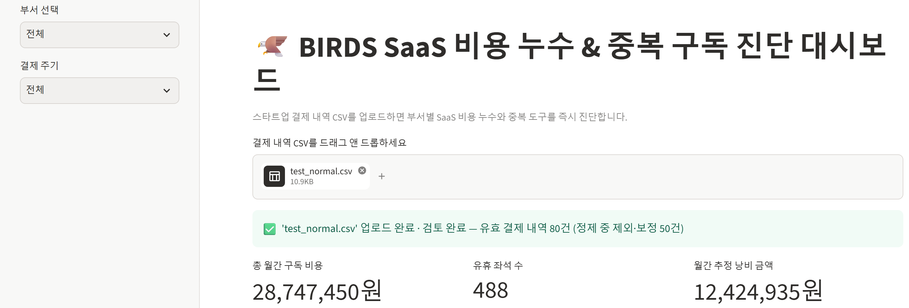
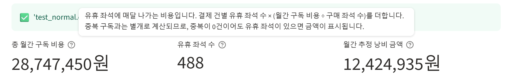
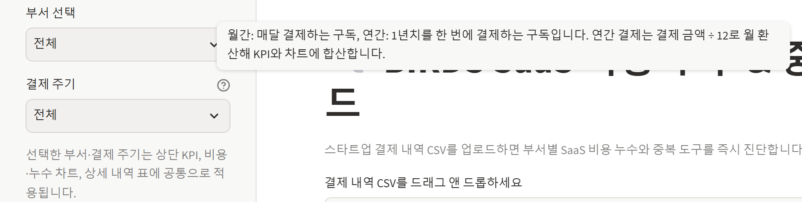
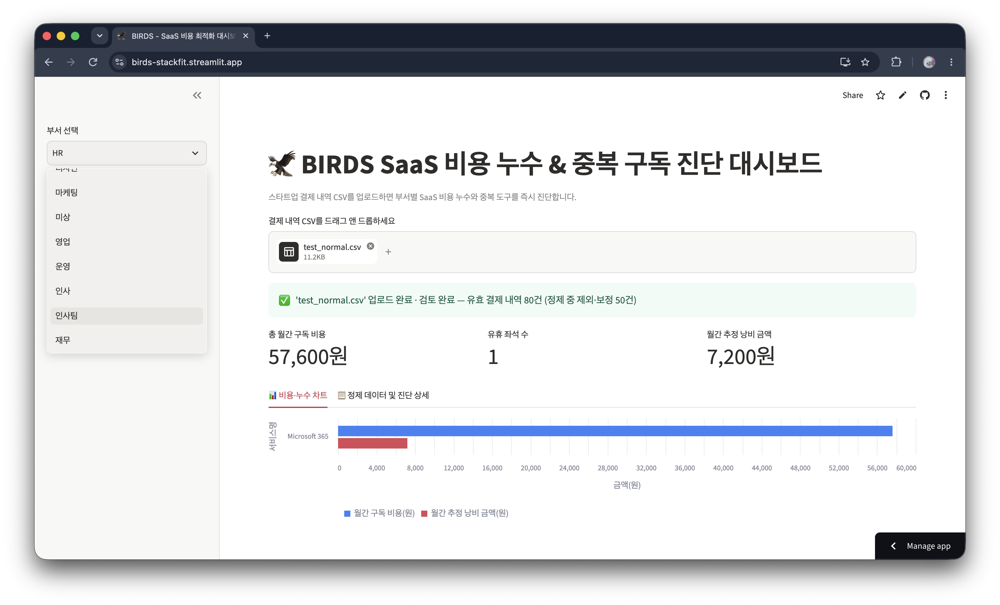
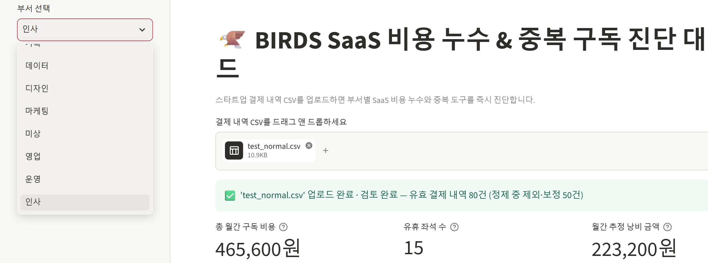

## [2026-11-24] KPI·결제 주기 help 툴팁 용어·산출 기준 보강 (피드백6·7·9) (담당: 박지우)
- **대상 모듈**: `app.py` / **관련 커밋**: `a4789be` -> `2ebe5d8`(피드백7 유휴 좌석 수), `9d70d8f`(피드백6 낭비 금액), `3500d12`(피드백9 결제 주기) (캡처: `9eb6b48`, 1차 반영: `7dc63d0`)
- **초기 프롬프트(요지)**: KPI·사이드바에 용어와 산출 기준 안내를 추가하라. 계산식은 `backend.py` 실제 로직 기준으로 쓰고, 그 외 기능은 추가하지 말 것. 이후 피드백 원문(6: 중복 0건인데 낭비액이 뜨는 이유, 7: 유휴 좌석 수 용어 정의, 9: 결제 주기 help 툴팁)과 대조해 구현 여부를 다시 점검하게 함.
- **AI 생성 결과(요지)**: 1차(`7dc63d0`)로 KPI 3종에 `help=` 계산식 툴팁, 사이드바에 `st.sidebar.caption` 안내를 추가함.
- **발견한 문제(취약점·오류·품질)**:
  1. [요구 미충족] 피드백 원문과 대조하니 1차 결과는 계산식만 적혀 있었음. 7번이 요구한 "유휴 좌석이 무엇인지"라는 용어 정의가 없었고, 6번이 물은 "중복 0건인데 낭비액이 뜨는 이유"에도 답하지 못함.
  2. [형식 불일치] 9번은 결제 주기 help 툴팁을 요구했으나 AI는 캡션으로 구현했고, 월간/연간의 의미 설명도 없었음.
  3. [커밋 단위] 처음 커밋 메시지 하나에 부서명 수정과 안내 문구가 섞여 피드백별 추적이 어려움.
- **수정 보완 내역**: 7번은 "구매했지만 실제로 쓰지 않는 좌석 수" 정의를 추가, 6번은 "중복 구독과는 별개로 유휴 좌석 기준으로 계산"됨을 명시, 9번은 결제 주기 `selectbox`에 `help=`로 월간/연간 의미와 ÷12 월 환산을 넣고 캡션에서는 해당 문장을 뺌. 계산 로직은 변경하지 않음. 커밋은 피드백별로 3개 + 캡처 1개로 분리함.
- **검증 및 판단 메모**: `pytest` 56 passed, 1 skipped (skip 1건은 정답지 샘플 파일 부재로 건너뛴 기존 테스트). 로컬 `streamlit run app.py`에 `test_normal.csv` 업로드 후 각 도움말 아이콘에 마우스를 올려 툴팁 문구를 확인함. 보조 도구: Claude(Claude Code, 코드 수정·캡처). AI 통제 교훈: AI는 "설명 추가"를 계산식 나열로 좁게 해석했으므로, 구현 후 피드백 원문의 질문에 실제로 답하는지 항목별로 대조해야 함.
- **브라우저 수동 검증 결과 (`streamlit run app.py`)**:
  - Before — 관찰: KPI 3종과 결제 주기 필터에 도움말 아이콘이 없어 용어·산출 기준을 화면에서 확인할 수 없음.
    
  - After 유휴 좌석 수(피드백7) — 관찰: "구매했지만 실제로 쓰지 않는 좌석 수입니다. 결제 건별 (구매 좌석 수 − 활성 사용자 수)를 더하며, 음수는 0으로 처리합니다." 툴팁 표시.
    
  - After 월간 추정 낭비 금액(피드백6) — 관찰: 산출식과 "중복 구독과는 별개로 계산되므로, 중복이 0건이어도 유휴 좌석이 있으면 금액이 표시됩니다." 툴팁 표시.
    
  - After 결제 주기(피드백9) — 관찰: 결제 주기 옆 도움말에 월간/연간 의미와 "연간 결제는 결제 금액 ÷ 12로 월 환산" 안내 표시.
    

## [2026-11-21] clean_billing_csv() 부서명 표기 통일로 합산 누락 수정 (피드백1) (담당: 박지우)
- **대상 모듈**: `core/data_processing.py`, `tests/test_clean_billing_csv.py`, `tests/test_integration.py` / **관련 커밋**: `492ee28` -> `b08487e` (캡처: `9eb6b48`)
- **초기 프롬프트(요지)**: 피드백("사이드바 부서명 표기 불일치(Data/데이터, HR/인사/인사팀 등)로 합산 누락")의 요지만 해결하라. 다른 팀원 구역은 건드리지 말고, 로컬에서 실행해 화면으로 확인한 뒤 커밋은 내가 승인한다.
- **AI 생성 결과(요지)**: `DEPARTMENT_ALIAS_MAP`과 `normalize_department()`를 추가해 공백 제거 → '~팀' 접미사 제거 → 영문 별칭(HR/Data/Sales) 한글 매핑을 적용함. 1차 결과에는 부서명이 바뀔 때마다 "보정" 경고를 남기는 로직과 사이드바 안내 문구도 포함됨.
- **발견한 문제(취약점·오류·품질)**:
  1. [범위 초과] 경고 기록과 안내 문구는 피드백 요지(합산 누락)와 무관하고, 경고 추가로 화면의 "제외·보정" 건수가 50건→56건으로 바뀌어 다른 팀원 테스트 기대값까지 흔듦.
  2. [기존 테스트 영향] '~팀' 접미사 제거로 `test_integration.py`의 기대값(`개발팀`, `기획팀`)이 깨짐(장형욱 님 담당 파일).
  3. [작업 방식] AI가 별도 브랜치에 커밋해, `main`에서 작업하는 팀원에게 커밋이 보이지 않았음.
  4. [확인] "미상"은 원본에서 부서 칸이 빈 결제(5건 중 제외 2건 → 3건)에 붙는 기존 처리로, 부서명 통일과는 별개임을 확인함.
- **수정 보완 내역**: 경고 기록과 안내 문구를 빼고 이름 통일만 남김(`clean_billing_csv` 4단계 1줄 변경). `test_integration.py`는 부서명 기대값 3줄만 `개발`/`기획`으로 수정. 단위 테스트 2건 추가: 여러 표기가 표준명으로 통일되는지, `Data`+`데이터`, `HR`+`인사`+`인사팀` 결제가 하나로 합산되는지. 브랜치는 `main`으로 fast-forward 반영 후 삭제함.
- **검증 및 판단 메모**: `pytest` 56 passed, 1 skipped. 샘플 CSV의 부서 표기 18종을 하나씩 넣어 통일 결과를 확인함(통일 대상 6종 8건, 나머지는 그대로). 실제 앱에서 부서를 하나씩 선택해 월간 비용을 더한 값이 "전체"(28,747,450원)와 일치해 누락이 없음을 확인함. 보조 도구: Claude(Claude Code, 코드 수정·테스트·캡처). AI 통제 교훈: AI는 "정제"를 이력 기록·안내까지 넓혀 구현하므로, 피드백 요지를 한 문장으로 고정하고 그 밖의 변경은 빼도록 범위를 직접 좁혀야 함.
- **브라우저 수동 검증 결과 (`streamlit run app.py`)**:
  - Before — 관찰: 부서 목록에 HR·인사·인사팀이 따로 노출되고, "HR" 선택 시 57,600원만 집계됨.
    
  - After — 관찰: 부서 목록에 "인사" 하나만 남고, "인사" 선택 시 465,600원으로 합산됨.
    

## [2026-11-16] app.py 사이드바 필터(B2-1)·핵심 지표 metric(B2-2) 구현 (담당: 박지우)
- **대상 모듈**: `app.py` / **관련 커밋**: `74d9f2d` -> `097c5cb`(사이드바 필터), `49a3d6d`(metric)
- **초기 프롬프트(요지)**: (B2-1) B2 구역에 `backend.get_filter_options`로 선택지를 받아 `st.sidebar.selectbox` 2개(부서·결제 주기)를 만들고, 선택값을 `backend.filter_and_summarize`에 넘겨 `summary`, `filtered_df`로 저장하라. `app.py` 안에서 pandas 가공 코드 금지, 다른 구역·`backend.py` 수정 금지, `st.metric`은 다음 작업으로 미룬다. (B2-2) `st.columns(3)` 안에 `summary` 값(총 월간 구독 비용, 유휴 좌석 수, 월간 추정 낭비 금액)을 `st.metric`으로 표시만 하라.
- **AI 생성 결과(요지)**: B2-1은 selectbox 2개와 `backend` 호출 16줄, B2-2는 `st.columns(3)` + `st.metric` 3개 11줄을 B2 구역에만 추가함. `backend.py`와 B1·B3 구역은 변경하지 않음.
- **발견한 문제(취약점·오류·품질)**:
  1. [규칙 점검] 프로젝트 4대 원칙을 diff와 대조함 — `app.py`에 `groupby`·`sum`·`df[...]` 등 직접 가공 0건(검색 확인), selectbox는 `key`만으로 동작해 별도 session_state 초기화 불필요, 구버전 API 없음. Copilot 생성 코드 자체의 결함은 발견하지 못함.
  2. [구조] 업로드 전에는 사이드바가 보이지 않음. 사이드바 코드가 B1의 `st.stop()` 아래에 있어 파일을 올리기 전에 스크립트가 멈추기 때문(의도된 동작이나 처음에는 미구현으로 오인함).
  3. [검증 범위] B2-1 단계에서는 필터 값을 화면에 표시하지 않아 동작을 눈으로 확인할 수 없었음. 프롬프트 범위를 단계별로 나눈 결과.
  4. [데이터 품질] 부서 필터에 같은 부서가 표기만 달라 분리됨(데이터/Data, 인사/인사팀/HR, 영업/Sales, 기획/기획팀, 경영지원/경영지원팀). 'Data' 선택 시 1건(700,000원)만 조회됨. 9주차에 `clean_billing_csv`의 department 표기 통일을 팀 확인 대기로 보류한 항목이 UI에서 드러남.
- **수정 보완 내역**: 1·2는 코드 수정 없음(규칙 준수 확인, 동작 원리 파악). 3은 B2-2에서 metric을 붙여 해소. 4는 정제 결과를 바꾸면 정답지 통합 테스트가 달라질 수 있어 이번 범위에서 제외하고 팀 확인 후 별도 처리하기로 함. 커밋 메시지 오타(`필터기능 ㄷ구현`)와 노션 지정 문구 불일치는 push 전에 수정함(파일 내용 변경 없음).
- **검증 및 판단 메모**: 브라우저(`streamlit run app.py`, `test_cp949.csv` 업로드, 유효 80건·제외·보정 50건)에서 사이드바 변경 시 지표가 즉시 갱신됨을 확인하고 백엔드 계산값과 대조함 — 전체/전체 28,747,450원·488석·12,424,935원, 전체/월간 23,347,500원·381석·9,817,618원, Data/전체 700,000원·11석·308,000원 모두 일치. 보조 도구: Copilot(코드 생성), Claude(Copilot 프롬프트 작성, diff 검토, 수치 대조). AI 통제 교훈: AI가 규칙을 지켜 코드를 만들었더라도 단계를 나누면 화면 검증이 늦어지므로, 검증 가능한 출력까지 한 번에 요청하는 것이 효율적임.

# AI 통제 기록 아카이브 (표준 5요소 양식)

## [2026-11-08] clean_billing_csv() 타입힌트·Docstring 및 가독성 리팩터링 (담당: 박지우)
- **대상 모듈**: `data_processing.py` / **관련 커밋**: `1860c39` -> `6ecf39e` (보완: `5a2097b`)
- **초기 프롬프트(요지)**: clean_billing_csv와 헬퍼 함수에 타입 힌트·Docstring을 보강하고, 열 목록 상수화·텍스트 변환 헬퍼 분리·벡터화를 하라. 단, 시그니처·단계 순서·경고 문구(숫자 표기 포함)·경고 순서·반환값은 그대로 유지하고, 결과가 같다고 확신할 수 없는 단계는 반복문을 유지하라.
- **AI 생성 결과(요지)**: `_coerce_text()` 헬퍼 분리, `REQUIRED_COLUMNS`·`EMPTY_COLUMNS` 상수화, 전 헬퍼에 타입 힌트와 Docstring 추가. `iterrows` 반복문은 대부분 유지.
- **발견한 문제(취약점·오류·품질)**:
  1. [문서-코드 불일치] Docstring "정제 단계 요약"에 tx_id 자동 발급이 2단계로 적혀 있으나, 실제 코드는 9단계 이후 마지막에 발급함.
  2. [명명 품질] `EMPTY_COLUMNS`는 실제로는 출력 열 목록이고, 두 상수가 mask_pii_data 상수 블록에 섞여 담당 범위가 불분명함.
  3. [요구 미반영] 벡터화가 거의 이뤄지지 않음.
- **수정 보완 내역**: Docstring을 실제 실행 순서로 정정하고, 상수를 `CLEAN_REQUIRED_COLUMNS`·`CLEAN_OUTPUT_COLUMNS`로 바꿔 clean 함수 영역으로 이동함(`5a2097b`). 벡터화는 경고 순서·문구 동일성을 보장할 수 없어 반복문 유지로 판단함.
- **검증 및 판단 메모**: 리팩터링 전후 샘플 데이터 결과를 저장해 비교 — 결과 80행, 열·타입, 경고 50건(문구·순서 포함) 모두 동일(`6ecf39e`, `5a2097b` 각각 확인). 전체 pytest 41 passed, 1 skipped(정답지 미포함으로 통합 테스트 skip). 테스트는 경고 문구·순서를 검사하지 않으므로, refactor 검증은 테스트 통과만으로는 부족하고 전후 출력 비교가 필요하다는 점을 확인함.

## [2026-11-02] clean_billing_csv() Copilot 생성 코드 결함 수정 (담당: 박지우)
- **대상 모듈**: `data_processing.py` / **관련 커밋**: `337b2fb` -> `fa58b67`, `529a2a7`
- **초기 프롬프트(요지)**: 결제내역 DataFrame을 9단계 규칙(중복 tx_id, 날짜 5형식, alias 표준화, 결제주기, 좌석·금액 검증, 월비용 환산)으로 정제하고 (정제 결과, 경고 목록)을 반환하는 함수를 작성하라. ※ 원본 생성 프롬프트는 채팅 기록에서 찾지 못해 prompt_log.md에 사후 재구성본으로 기록함.
- **AI 생성 결과(요지)**: 9단계 정제 로직을 iterrows 기반으로 생성. 샘플 데이터 실행 시 `KeyError: monthly_cost_krw` 발생.
- **발견한 문제(취약점·오류·품질)**:
  1. [오류] 8단계에서 이미 숫자로 바뀐 금액을 parse_amount로 재파싱 → 전 행 제외 → KeyError
  2. [오류] 카탈로그에 등록된 서비스명에도 "미등록" 경고 발생
  3. [오류] 빈 tx_id 자동 발급이 검증 전에 실행되어, 제외될 행이 번호를 차지함
  4. [품질] 숫자 열이 float로 남음
  5. [경계] 빈 DataFrame이면 필수 열 누락을 검사하지 않고 빈 결과를 반환 (테스트 T07로 확인)
- **수정 보완 내역**: 1~4는 `fa58b67`, 5는 검사 순서 변경으로 `529a2a7`에서 수정. 미사용 parse_amount 삭제. department 표기 통일은 팀 확인 대기로 유지.
- **검증 및 판단 메모**: pytest 7개(정상·경계·예외·통합) 통과, 통합 테스트는 샘플 100행 → 정답지 80행과 일치. 결함 원인 진단과 테스트 설계에 Claude를 보조로 사용했고, 코드 생성·수정은 Copilot으로 함. AI 생성 코드는 실행해 보기 전에는 결함이 드러나지 않았으므로, 실데이터 통합 테스트를 먼저 만들어 두는 것이 효과적이었음.
