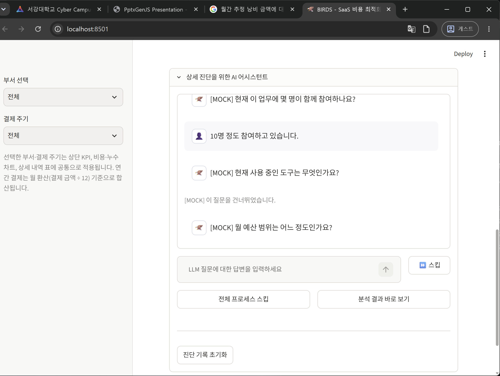

## [2026-11-23] llm 역질문 챗봇 기능 구현 (담당: 김서연)
- **대상 모듈**: app.py & backend.py / **관련 커밋**: 998695c -> 6360369
- **초기 프롬프트(요지)**: 부족한 정보를 얻기 위한 llm 역질문 챗봇 ui를 만들어라. streamlit ui와 관련한 코드만 app.py에 작성하고, 나머지 백엔드 구현은 모두 backend.py에 작성해야 한다. 제공할 질문은 llm_utils.py의 세 함수를 이용해 얻는다. 사용자는 질문에 대답하거나 건너뛸 수 있고, 전체 대화를 스킵하는 버튼 또한 필요하다. 질문이 모두 끝났거나 전체가 스킵되면 '진단 결과 보러 가기'를 띄운다. 이 부분은 아직 구현하지 않는다. 기존 st.expander에 스크롤 박스 형태로 구현하도록. 대화 초기화 기능도 넣을 것.
- **AI 생성 결과(요지)**: st.form과 st.text_input을 이용해 사용자로부터 답변을 받고, 질문 스킵, 전체 스킵, 진단 결과 보기, 대화 초기화 버튼 구현. @st.dialog를 통해 초기화 확인용 팝업을 만들었고, ui 외 llm 호출로 질문 받아오기, 대화 상태 갱신(답변으로 정보 공백 채우기) 기능은 모두 backend.py에 각각의 함수로 구현함. ui를 위해 st.container와 st.columns를 사용함.
- **발견한 문제(취약점·오류·품질)**: 

    1) [app.py] '이 질문 스킵' 버튼이 자주 잘려 보임(이 질문...). 마우스를 올려 놓으면 내용이 뜨기는 하지만, 사용자가 직관적으로 기능을 파악하기 어려움.
    2) [backend.py] reset_chat라는 함수는 내부에서 실질적으로 initialize_chat 함수만을 불러오며, 추가적인 기능을 하지 않음. 함수 이름을 직관적으로 하기 위한 조치로 생각되나, 이는 불필요한 함수의 중복 선언이라고 볼 수 있음.
    3) [app.py] '이 질문 스킵'에 불필요한 st.session_state 부여. skipped이라는 변수를 사용하기 때문에 버튼 정보를 저장할 필요가 없음.  
    st.chat_input 대신 st.form과 st.text_input의 조합을 사용. st.chat_input은 간편하게 메시지 입력 칸을 구현할 수 있는데, 그 대신 직접 구현을 선택함.
    4) [backend.py] initialize_chat에서 slot_id가 존재하지 않을 때 받아오는 값을 "C-01"과 같이 지정했는데, 임의로 slot_schema의 id 값을 부여하는 것은 위험하다고 판단.  
    submit_chat_answer이 호출될 때마다 round_number를 증가시킴. llm 호출시 받는 질문 묶음에 대해 round_number을 부여하는 것인데, submit_chat_answer는 각 질문에 대해 모두 호출됨. 즉, 같은 round_number여야 하는 질문들에 잘못된 번호가 부여됨.
    5) [app.py] 스크롤 박스를 구현했는데, 질문과 답변 묶음의 개수에 대해서만 박스 높이를 고정함. 즉, 만약 해당 개수 미만임에도 불구하고 텍스트 용량이 크다면 의도보다 박스의 크기가 커지게 됨.  
    llm 챗봇에 대한 안내 문구가 존재하지 않고, 버튼 등에 사용된 어휘가 사용자 친화적이지 않음.

- **수정 보완 내역**: 

    1) [app.py] '⏩ 스킵'으로 수정하여 적은 텍스트 양으로 웬만해서는 잘리지 않도록 하였으며, 설령 잘리더라도 아이콘을 통해 기능을 쉽게 파악할 수 있도록 보완함.
    2) [backend.py] reset_chat을 initialize_chat으로 바꾼 후 삭제함. llm 대화 초기화의 경우, reset_chat이 아니라 initialize_chat을 그대로 써도 코드 이해에 어려움이 전혀 없음.
    3) [app.py] '이 질문 스킵' 버튼에 st.session_state 부여를 삭제함.  
    st.chat_input으로 구조를 바꿔 간단하게 입력창을 표시하도록 수정함.
    4) [backend.py] slot_id를 알 수 없을 때 "NA-01"과 같이 저장하도록 형식을 수정함.  
    get_ai_reply를 호출할 때만, 즉 새로운 질문 묶음을 받을 때만 round_number를 증가시키도록 수정함.
    5) [app.py] 질문과 답변 묶음 개수 외에도 전체 대화 내역의 글자 수를 계산하여 값이 커지면 높이가 고정되도록 함.  
    st.expander에 이 llm 챗봇 상호작용에 대한 안내 문구를 추가함. 'llm 챗봇 새로 시작하기' -> '진단 기록 초기화'와 같이 조금 더 기능에 충실한 어휘로 수정함.

- **검증 및 판단 메모**: pytest 56 passed, 1 skipped로 모든 케이스를 정상 통과함. 실제 app 호출 결과는 아래 항목에 작성함. llm이 st.button과 같은 요소를 만들 때, 요소 구분을 위해 key= 사용이 빈번하다는 사실을 알게 됨. 앞으로의 streamlit 구현에 있어서 st.session_state 검증이 꼭 필요하다는 것을 다시 확인함.
- **브라우저 수동 검증 결과**: st.expander 클릭 시 의도한 설명 문구가 제대로 노출되고, 진단 시작을 누르면 아래 캡처 사진과 같이 llm과의 대화 내역과 입력창, 다양한 버튼이 뜨는 것을 확인함. 아래 캡처는 첫 번째 질문에 답변, 두 번째 질문에 스킵한 화면임.  


---

## [2026-11-16] 서비스별 비용·누수 bar chart 구현 및 원본 표 제시, 상세 진단 탭 구현 (담당: 김서연)
- **대상 모듈**: app.py / **관련 커밋**: e538d2f -> 7d42260, e3a7ffa, c0ccfc2
- **초기 프롬프트(요지)**: 비용·누수 차트 탭과 정제 데이터 및 진단 상세 탭(st.tabs)을 만든다. 전자는 기존에 정제한 df로 backend.get_chart_data(df)를 호출하여 st.bar_chart로 그 결과를 그린다. 후자는 원본 df를 그대로 출력하고, st.expander로 중복 의심 태그와 llm 역질문을 보여준다. llm 대화창은 아직 구현하지 않는다. 각 출력에서 해당하는 데이터가 없을 경우 st.info로 사용자에게 알린다. 절대 데이터 가공 로직이 포함되어서는 안 되며, 모든 데이터 가공은 backend 함수를 호출하면서 진행할 것.
- **AI 생성 결과(요지)**: st.tabs로 탭 두개를 구현. backend.get_chart_data(df)를 호출해 값을 받고, empty라면 info로 경고, 아니면 세로 막대 chart 출력. "정제된 결제 내역" 제목의 원본 df 출력. "중복 의심 태그 보기", "추가 진단을 위한 LLM 역질문" st.expander 구현. llm에 "진단하러 가기" 버튼 구현. 현재는 st.info로 미구현을 알림.
- **발견한 문제(취약점·오류·품질)**: 

    1) bar_chart의 지나친 width와 낭비 금액의 부재:  
    만약 서비스명이 한 개라면 세로 막대 바의 너비가 너무 커지는 문제를 발견. 낭비 금액의 경우 ai 코드의 문제가 아닌 backend.py의 부족한 구현임을 확인.
    2) llm 진단하러 가기 버튼의 불필요한 st.session_state 부여:  
    이후 페이지 이동 구현할 때는 어떻게 될 지 아직 확정할 수 없지만, 현재로서는 버튼 클릭 시 st.info로 메시지만 출력하면 되기 때문에 session_state는 불필요하다고 판단.
    3) 중복 의심 태그의 필터링 부재와 부족한 가독성:  
    현재 bar chart와 원본 df는 모두 선택된 필터를 적용한 결과를 보여주지만, 중복 의심 태그는 전체에 대한 결과만 출력. 또, list 구조를 그대로 보여주어 사용자가 데이터를 파악하기 어려움.
    4) 어휘 선택의 아쉬움:  
    "정제된 결제 내역", "중복 의심 태그 보기", "추가 진단을 위한 LLM 역질문"과 같이 사용자에게 전달하기에는 다소 아쉬운 표현들이 다수 존재.

- **수정 보완 내역**: 

    1) (7d42260) backend.get_chart_data에 낭비 금액 컬럼을 계산하는 코드를 추가.  
    (c0ccfc2) 낭비 금액을 red, 총 비용을 blue로 하고 가로 막대 형식으로 하여 서비스 개수가 적어도 막대 너비가 커지지 않도록 조정함. 낭비 금액, 총 비용 순으로 내림차순으로 정렬했으며 서비스 개수가 너무 많을 경우 상위 10개만 표시한 후 전체를 볼 수 있도록 toggle을 설정함.
    2) (c0ccfc2) session_state를 부여하는 key="go_to_diagnosis" 부분 삭제.
    3) (e3a7ffa) backend.get_duplicate_table를 추가로 구현하여 필터 적용 중복 태그를 구한 후 df로 반환.  
    (c0ccfc2) 함수 호출로 반환받은 df를 출력하여 사용자가 중복 의심 쌍을 표의 구조로 볼 수 있도록 함.
    4) (c0ccfc2) 원본 표에 caption을 추가하여 데이터 정제로 만들어진 열을 알림. 중복 의심 태그라는 표현 대신 기능 중복 의심 몇 건으로 수정하여 expander를 펼치지 않아도 요약 정보를 알 수 있도록 함. llm 역질문에서 caption으로 불필요하게 질문 외 정보를 노출한 부분을 삭제. 

- **검증 및 판단 메모**: normal data에 대해(잘못된 csv는 upload 기능에서 걸러짐) 필터에 따라 알맞은 차트, 원본 표, 중복 의심 표가 출력됨을 검증함. AI는 프롬프트에 명시되지 않은 부분을 임의로, 또는 통상적으로 많이 사용되는 패턴으로 채워넣기 때문에 의도하지 않은 표현들이 나타날 수 있음을 확인함. 이로써 AI 프롬프트 작성 이전에 구체적인 설계의 중요성을 다시 한 번 실감할 수 있었음.

---

## [2026-11-07] calculate_seat_leakage 리팩터링 (담당: 김서연)
- **대상 모듈**: quant_analysis.py / **관련 커밋**: bab191c -> adfe105
- **초기 프롬프트(요지)**: calculate_seat_leakage의 시간 복잡도를 분석하고, pandas 벡터화 개선안을 제시하라. 현재의 함수 계약(반환 SeatLeakage: dict 구조)은 유지할 것.
- **AI 생성 결과(요지)**: iterrows() 대신 to_dict("records") 사용으로 벡터화 제안. 반환 구조는 제대로 유지함.
- **발견한 문제(취약점·오류·품질)**: 불필요한 .rename_axis("service_name"), line 79  
-- "service_name"에 대해 groupby하기 때문에 .sum()의 결과로 이미 axis의 이름이 "service_name"이 된다.
- **수정 보완 내역**: line 79는 삭제하고 to_dict 벡터화 로직은 채택
- **검증**: pytest 3/3 통과 (실행 로그 첨부), 커밋 adfe105
- **판단 메모**: AI가 '개선'한 코드 또한 개선의 대상이 될 수 있음을 확인.  
-- 이후 AI 개선 코드를 늘 라인별로 읽으면서 불필요한 부분이 없는지 주의깊게 읽어보기로 함.

## [llm_utils] build_prompt_template - 2026-11-09, 작성자: 김서연
- 사용 도구: GitHub Copilot Chat
- 프롬프트:
```
목적에 맞는 프롬프트를 반환하는 함수를 llm_utils.py에 구현하라.

[함수 시그니처 - 변경 금지]
def build_prompt_template(purpose: PromptPurpose, state: ConversationState, extra_data: dict | None = None) -> str:

다음 타입 별칭도 유지하라.
PromptPurpose = Literal["question", "context", "report"]
class ConversationState(TypedDict, total=False):
    session_id: str
    round_number: int

    process_codes: list[str] (slot_schema.json 참고)
    process_candidates: list[dict[str, Any]]

    filled_slots: dict[str, SlotValue]
    missing_slots: list[str]
    skipped_slots: list[str]

    question_history: list[dict[str, Any]]
    answer_history: list[dict[str, Any]]

    workflow_summary: str
    bottleneck_memo: str
    culture_notes: str
    must_keep: list[str]

    can_finish_now: bool
    user_requested_finish: bool

단, 현재 프로젝트의 방향에 맞게 DTO는 dataclass보다는 TypedDict를 우선 사용하라.

다음 DTO 구조를 기준으로 프롬프트 출력 형식을 설계하라.

class SlotValue(TypedDict):
    value: Any
    source: Literal["user", "csv", "analysis", "llm"]
    evidence: str
    round_number: int

class QuestionItem(TypedDict):
    question: str
    slot_id: str
    category: str
    priority: Literal["required", "conditional", "optional"]

class QuestionBatch(TypedDict):
    round_number: int
    questions: list[QuestionItem]
    can_finish_now: bool

class CompanyContext(TypedDict):
    process_codes: list[str] (slot_schema.json 참고)
    summary: str
    filled_slots: dict[str, Any]
    missing_slots: list[str]
    workflow_summary: str
    bottleneck_memo: str
    culture_notes: str
    must_keep: list[str]

class FinalReport(TypedDict):
    summary: str
    candidate_sets: list[dict[str, Any]]

그러나 이 함수는 위 DTO를 직접 생성하지 않는다. 각 목적에 맞는 JSON 출력 형식을 LLM에게 지시하는 프롬프트 문자열을 생성하는 함수다.

[입력 명세]
purpose: "question", "context", "report" 중 하나다. 각각 질문 묶음 생성하기, 현재까지의 데이터로 기업 맥락 분석하기, 최종 추천 리포트 구성하기를 목적으로 한다.
state: 현재 대화 상태를 나타낸다. 최소한 다음과 같은 데이터가 들어올 수 있다.
{
    "round_number": 1,
    "process_codes": ["P3"],
    "filled_slots": {
        "C-01": {
            "value": "6~20명",
            "source": "user",
            "evidence": "팀은 12명이라고 답변함",
            "round_number": 1
        }
    },
    "missing_slots": ["C-02", "C-03", "P3-S01"],
    "skipped_slots": [],
    "question_history": [],
    "answer_history": [],
    "workflow_summary": "",
    "bottleneck_memo": "",
    "culture_notes": "",
    "must_keep": []
}
state가 가진 내용을 프롬프트에 포함하되, 원본 대화와 현재 정리된 상태를 혼동하지 않도록 명시하라.
extra_data: Python에서 이미 계산한 추가 분석 결과다. 예시는 다음과 같다.
{
    "billing_summary": {
        "services": ["Notion", "Slack", "Jira"],
        "departments": ["개발", "마케팅"],
        "monthly_total_krw": 1200000
    },
    "seat_leakage": [],
    "duplicate_pairs": [],
    "slot_schema": {},
    "candidate_tools": [],
    "pricing_simulation": [],
    "contract_warnings": []
}
extra_data는 선택값이다. None이면 빈 객체로 처리하라.

[출력 명세]
프롬프트 전문 str
반드시 다음의 내용을 포함해야 한다.

프로젝트의 역할과 목적, 입력 데이터에 없는 사실을 추측하지 말라는 규칙, 사용자 입력이나 분석 결과에 근거하지 않은 값을 확정하지 말라는 규칙, JSON 객체 하나만 출력하라는 규칙, 현재 state, 현재 extra_data, purpose별 작업 지시, purpose별 JSON 출력 형식(아래 예시 제시)
- purpose = "question"
{
  "round_number": 1,
  "questions": [
    {
      "question": "질문 내용",
      "slot_id": "C-01",
      "category": "팀 규모",
      "priority": "required"
    }
  ],
  "can_finish_now": false
}
- purpose = "context"
{
  "process_codes": ["P1", "P3"],
  "summary": "기업 상황 요약",
  "filled_slots": {},
  "missing_slots": [],
  "workflow_summary": "업무 흐름",
  "bottleneck_memo": "병목과 반복 작업",
  "culture_notes": "조직 성향과 도입 저항",
  "must_keep": ["Slack"]
}
- purpose = "report"
{
  "summary": "최종 진단 요약",
  "candidate_sets": [
    {
      "set_id": 1,
      "title": "균형형",
      "fit_percent": 94,
      "monthly_cost_krw": 0,
      "monthly_saving_krw": 0,
      "matching_reasons": [],
      "tradeoffs": [],
      "recommendations": [],
      "approval_summary": "대표 결재용 요약"
    }
  ]
}

[프롬프트에 명시할 규칙]
1. purpose = "question"
- 3~5개 질문을 생성한다.
- missing_slots에 있는 슬롯만 질문 대상으로 삼는다.
- filled_slots와 skipped_slots에 있는 슬롯은 다시 묻지 않는다.
- slot_schema가 제공되면 슬롯 정의와 우선순위를 따른다.
- 질문의 slot_id는 제공된 schema에 존재하는 값만 사용한다.
- 정확도나 충족률은 LLM이 계산하지 않는다.
- 정확도 계산은 이후 Python 코드가 담당한다.
2. purpose = "context"
- process_codes는 여러 개일 수 있다.
- CSV의 서비스 목록만으로 프로세스를 확정하지 않는다.
- CSV와 정량 분석 결과는 초기 단서로만 사용한다.
- 사용자의 직접 답변을 가장 우선적인 근거로 사용한다.
- 사용자가 답하지 않은 값은 filled_slots에 넣지 않는다.
- 추정값은 확정값처럼 저장하지 않는다.
- 중복 의심 도구는 즉시 해지 대상으로 단정하지 않는다.
- workflow_summary, bottleneck_memo, culture_notes는 사용자 답변에 근거해 작성한다.
- must_keep는 사용자가 반드시 유지해야 한다고 밝힌 도구만 넣는다.
- 아직 필요한 슬롯은 missing_slots에 남긴다.
3. purpose = "report"
- 후보 세트는 최대 3개까지 생성한다.
- candidate_tools와 pricing_simulation에 있는 도구만 사용한다.
- 비용과 절감액은 Python 계산값을 그대로 사용한다.
- LLM이 비용을 새로 계산하거나 변경하지 않는다.
- must_keep 도구는 해지/교체 대상으로 제안하지 않는다.
- contract_warnings가 있는 도구는 주의 문구를 포함한다.
- 각 후보 세트마다 장점, 매칭 근거, Trade-off를 포함한다.
- 근거가 없는 수치와 기능을 만들어내지 않는다.

[요구사항]
함수는 다음 순서로 동작해야 한다.
1. purpose가 "question", "context", "report" 중 하나인지 검사한다.
2. 허용되지 않은 값이면 ValueError를 발생시킨다.
3. state를 JSON 직렬화 가능한 형태로 변환한다.
4. extra_data가 None이면 빈 객체로 처리한다.
5. 공통 시스템 지침과 현재 상태를 프롬프트에 포함한다.
6. purpose에 따라 서로 다른 작업 지침과 JSON 출력 형식을 추가한다.
7. 완성된 프롬프트 문자열을 반환한다.

[예외 및 경계 방침]
- purpose가 허용되지 않은 문자열일 경우, ValueError
- state가 ConversationState 타입이 아닌 경우, TypeError
- extra_data가 지정되었지만 dict가 아닐 경우, TypeError
- extra_data가 None인 경우 {}로 처리한다.
- state 또는 extra_data에 JSON 직렬화가 어려운 값이 있더라도 프롬프트 생성 단계에서 조용히 실패하지 않는다. 가능하면 명확한 변환 함수를 사용하고, 변환할 수 없는 값이면 TypeError 또는 ValueError를 발생시킨다.
- "question"일 때, state에 filled_slots, missing_slots, process_codes가 없어도 프롬프트 생성 자체는 가능하게 한다. 단, 해당 값이 없다는 사실을 프롬프트에 명시한다.
- "context", "report"일 때, ConversationState가 비어있고 extra_data가 None이면, ValueError
- 원본 CSV를 직접 받지 않으며, 대용량 원본 데이터가 들어오더라도 함수 내부에서 임의로 잘라내거나 조용히 버리지 않는다.


[제약 조건]
- 원본 csv 전체를 직접 요구하거나 포함하지 말라. 개인정보와 불필요한 거래 상세를 LLM에 전달하지 말고, Python에서 집계한 요약 데이터만 사용한다는 원칙을 프롬프트에 포함하라.
- 타입 힌트와 docstring 필수, 가변 기본값 인자 금지
- 광범위한 except Exception으로 오류를 숨기지 않는다
- 원본 PII를 프롬프트에 넣지 않는다
- 프롬프트 문자열 안에 실제 API 키나 비밀 값을 넣지 않는다

[통과해야 할 테스트]
1. purpose="question"과 정상적인 상태를 전달했을 때:
- 반환값이 str이다.
- 반환 문자열에 PROMPT_PURPOSE=question이 포함된다.
- 반환 문자열에 filled_slots, missing_slots 또는 현재 상태 내용이 포함된다.
- 질문 묶음 JSON 출력 형식이 포함된다.
2. 허용되지 않은 목적, "analysis"을 전달했을 때, ValueError가 발생한다.
3. extra_data=None이고 빈 상태를 전달했을 때:
prompt = build_prompt_template("context", {}, None)
ValueError가 발생한다.
4. extra_data=None이고 빈 상태를 전달했을 때:
prompt = build_prompt_template("question", {}, None)
- 예외가 발생하지 않는다.
- 반환값이 str이다.
- 반환 문자열에 PROMPT_PURPOSE=question이 포함된다.
- 현재 filled_slots, missing_slots 또는 현재 상태 내용이 포함되지 않음을 명시한다.
- 질문 묶음 JSON 출력 형식이 포함된다.
```
- 생성 코드 위치: 커밋 3fdf23d
- 코드 리딩에서 발견한 결함:

    1) 불필요한 ```from __future__ import annotations```  
    모든 변수들이 함수 정의 전에 선언되었으므로 타입 힌트의 지연 평가가 필요없다. 따라서 해당 줄을 삭제했다.
    2) docstring의 모호함  
    한글로 번역하고, Args, Returns, Raises를 포함시켰다.
    3) 불필요한 입력 토큰 낭비  
    ConversationState에서 question_history와 answer_history는 갈수록 크기가 늘어날 수 있다. 그러나 filled_slots와 skipped_slots를 통해 어떤 질문을 했는지 그 주제를 알 수 있고, filled_slots.evidence를 통해 답변의 요지 또한 파악할 수 있다. 따라서 프롬프트에 question_history와 answer_history를 포함하지 않도록 수정했다.  
    또, 보조 함수 _serialize_json을 보면 indent=2로 들여쓰기를 하는 것을 볼 수 있다. 그러나 이는 사람의 가독성을 높이기 위한 것이지 llm 프롬프트로는 입력 토큰만 늘릴 뿐이다. 이에 불필요한 들여쓰기를 제거했다.
    4) 정돈되지 않은 프롬프트  
    프롬프트 템플릿에 '원본 CSV 전체를 요구하거나 프롬프트에 포함하지 말고, 개인정보와 불필요한 거래 상세를 LLM에 전달하지 마라.'와 같이 코드 생성을 위해 요청했지만 llm 프롬프트에 들어가지 않을 내용을 포함한 정황을 발견, 이를 삭제했다. "report" 파트에서 표현의 일관성을 위해 '도구' 표현 대신 '툴' 표현으로 대체했다.

- 수정 내역: 커밋 221139d
- 테스트 결과: pytest 4 passed

## [llm_utils] parse_and_validate_json - 2026-11-09, 작성자: 김서연
- 사용 도구: GitHub Copilot Chat
- 프롬프트:
```
llm 원문 응답을 파싱하는 함수를 llm_utils.py에 덧붙여 작성하라.

[함수 시그니처 - 변경 금지]
def parse_and_validate_json(raw_response: str, schema: type[DTO]) -> DTO:

[입력 명세]
raw_response: llm 원문 응답 문자열이다.
schema: 출력 형식을 알려준다. 즉, 어떤 TypedDict인지를 알려준다. llm_utils.py의 윗부분에 정의된 QuestionBatch, CompanyContext, FinalReport 중 하나이다.

[출력 명세]
출력 형식에 맞춘 TypedDict를 반환한다.

[요구사항]
1. 마크다운 코드 제거
2. json load하기
3. type에 맞는 필수 열들을 갖고 있는지 테스트

[예외 및 경계 방침]
- raw_response가 문자열이 아니면, ValueError
- schema가 유효한 type이 아니면 TypeError
- json.loads 실패 시, ValueError
- json.loads 결과가 dict가 아닐 시, TypeError
- type이 요구하는 필수 키가 없거나 허용되지 않은 키가 존재할 시, ValueError

[제약 조건]
- 타입 힌트와 docstring 필수, 가변 기본값 인자 금지

[통과해야 할 테스트]
- raw_response = "{
                "round_number": 1,
                "questions": [
                    {
                        "question": "[MOCK] 현재 이 업무에 몇 명이 함께 참여하나요?",
                        "slot_id": "[MOCK] C-01",
                        "category": "[MOCK] 팀 규모",
                        "priority": "[MOCK] required",
                    }
                ],
                "can_finish_now": False,
            }"
schema = QuestionBatch
return {
                "round_number": 1,
                "questions": [
                    {
                        "question": "[MOCK] 현재 이 업무에 몇 명이 함께 참여하나요?",
                        "slot_id": "[MOCK] C-01",
                        "category": "[MOCK] 팀 규모",
                        "priority": "[MOCK] required",
                    }
                ],
                "can_finish_now": False,
            }
- raw_response = "{
                "round_number": 1,
                "questions": [
                    {
                        "question": "[MOCK] 현재 이 업무에 몇 명이 함께 참여하나요?",
                        "slot_id": "[MOCK] C-01",
                        "category": "[MOCK] 팀 규모",
                        "priority": "[MOCK] required",
                    }
                ],
                "can_finish_now": False,
            }"
schema = CompanyContext
ValueError
- raw_response = "{
                "round_number": 1,
                "questions": [
                    {
                        "question": "[MOCK] 현재 이 업무에 몇 명이 함께 참여하나요?",
                        "slot_id": "[MOCK] C-01",
                        "category": "[MOCK] 팀 규모",
                        "priority": "[MOCK] required",
                    }
                ],
                "can_finish_now": False,
            }"
schema = SlotValue
TypeError
- raw_response = "```json {
                "round_number": 1,
                "questions": [
                    {
                        "question": "[MOCK] 현재 이 업무에 몇 명이 함께 참여하나요?",
                        "slot_id": "[MOCK] C-01",
                        "category": "[MOCK] 팀 규모",
                        "priority": "[MOCK] required",
                    }
                ],
                "can_finish_now": False,
            }```"
schema = QuestionBatch
return {
                "round_number": 1,
                "questions": [
                    {
                        "question": "[MOCK] 현재 이 업무에 몇 명이 함께 참여하나요?",
                        "slot_id": "[MOCK] C-01",
                        "category": "[MOCK] 팀 규모",
                        "priority": "[MOCK] required",
                    }
                ],
                "can_finish_now": False,
            }
```
- 생성 코드 위치: 커밋 fe31271
- 코드 리딩에서 발견한 결함:

    1) list 내부가 또 다른 list이거나 원시 타입(int, str 등)일 때 버그 위험  
    현재 _validate_typed_dict_keys는 schema 구조를 확인 후, 각각의 키에 대해 재귀적으로 구조를 검사한다. 만약 schema가 list[str], list[int] 등 원시 타입이거나 list[list[int]]처럼 이중 리스트라면 아무 에러 없이 종료된다. 함수가 시작 부분에서 is_typeddict로만 검사하고 있기 때문이다. 즉, 스키마가 list[int]일 때 ["apple"]처럼 주어져도 에러가 일어나지 않게 된다.  
    이에 함수 마지막에 isinstance(value, schema) 로직을 추가하여 안전성을 높였다.
    2) 코드펜스 포함 응답이 처음에 위치하지 않으면 감지하지 못함  
    만약 코드펜스 응답 전에 사족이 붙어있다면 맨앞과 뒤만 체크하는 지금의 방식을 해당 응답을 놓치게 된다. 따라서 정규 표현식을 수정하여 코드펜스가 어디 위치 하더라도 추출할 수 있도록 변경했다. 나머지 사족 유형들은 자칫 잘못 로직에 포함시키려다 틀린 응답을 옳게 처리하게 될 위험이 있으므로(+ 프롬프트에 형식을 명확히 지정함) 방어는 이 정도만 처리하도록 하겠다.
    3) _JSON_SCHEMAS 타입 체크 하드코딩  
    혹시라도 새로운 응답 스키마가 늘어난다면 스키마 체크 후 TypeError 메시지를 그때그때 수정해 주어야 해서 번거로울 수 있다. 이에 에러 메시지를 동적으로 변경하였다.

- 수정 내역: 커밋 993c654
- 테스트 결과: pytest 4 passed