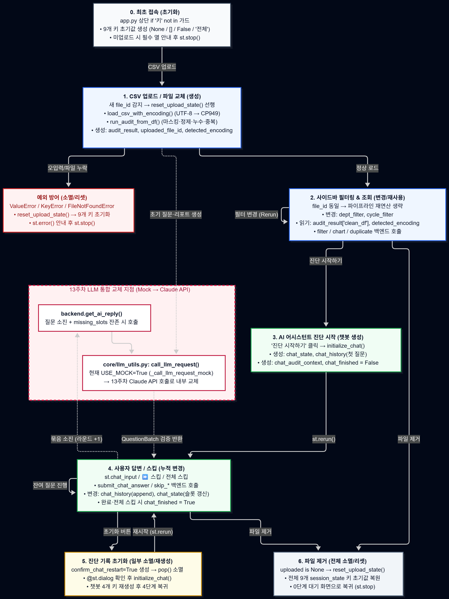

## 1. `st.session_state` 전체 키 정리 표 (10개 키)

| 키 이름 | 자료형 | 초기화 위치 | 읽는 곳 | 쓰는 곳 |
| :--- | :--- | :--- | :--- | :--- |
| `audit_result` | `dict` / `None` | `app.py` 상단 초기화 가드 (`None`) | 결과 배너(`row_count`, `warning_count`), 사이드바·KPI용 `clean_df`, 챗봇 초기 질문·컨텍스트 생성 | `reset_upload_state()`(`None`), 새 CSV 업로드 시 `backend.run_audit_from_df()` 반환값 저장 |
| `uploaded_file_id` | `str` / `None` | `app.py` 상단 초기화 가드 (`None`) | 새 파일 여부 판별(`!= uploaded.file_id`)로 Rerun 시 재연산 방지 | `reset_upload_state()`(`None`), CSV 분석 성공 직후 `uploaded.file_id` 저장 |
| `detected_encoding` | `str` / `None` (`"utf-8"` / `"cp949"`) | `app.py` 상단 초기화 가드 (`None`) | 결과 안내 영역(`== "cp949"`일 때 `st.warning` 유지 표시) | `reset_upload_state()`(`None`), `backend.load_csv_with_encoding()` 반환 인코딩 저장 |
| `dept_filter` | `str` | `app.py` 상단 `FILTER_DEFAULTS` 루프 (`"전체"`) | 사이드바 `selectbox` 반환값(`selected_dept`) → `backend.filter_and_summarize()` 전달 | `reset_upload_state()`(`"전체"`), 사이드바 `부서 선택`(`key="dept_filter"`) 조작 시 자동 갱신 |
| `cycle_filter` | `str` | `app.py` 상단 `FILTER_DEFAULTS` 루프 (`"전체"`) | 사이드바 `selectbox` 반환값(`selected_cycle`) → `backend.filter_and_summarize()` 전달 | `reset_upload_state()`(`"전체"`), 사이드바 `결제 주기`(`key="cycle_filter"`) 조작 시 자동 갱신 |
| `chat_state` | `dict` / `None` (`ConversationState` 확장) | `app.py` 상단 초기화 가드 (`None`) | AI 어시스턴트 시작 전/진행 중 분기, `current_questions`·`end_reason` 조회, 챗봇 백엔드 입력 | `reset_upload_state()`(`None`), `initialize_chat`·`submit_chat_answer`·`skip_*` 결과, 재시작 팝업 |
| `chat_history` | `list[dict[str, str]]` | `app.py` 상단 초기화 가드 (`[]`) | 채팅창 높이 계산(`total_characters`, `len`), `st.chat_message`·`st.caption` 누적 렌더링 | `reset_upload_state()`(`[]`), 챗봇 시작·재시작 시 초기 대입, 답변·개별/전체 스킵 시 `append()` |
| `chat_finished` | `bool` | `app.py` 상단 초기화 가드 (`False`) | 챗봇 완료 배너 vs 입력창 분기(`chat_finished or not questions`) | `reset_upload_state()`(`False`), 시작·재시작(`False`), 답변·개별 스킵(`result["finished"]`), 전체 스킵(`True`) |
| `chat_audit_context` | `dict` / `None` | `app.py` 상단 초기화 가드 (`None`) | `backend.submit_chat_answer()`, `backend.skip_chat_question()` 컨텍스트 인자 전달 | `reset_upload_state()`(`None`), 챗봇 시작·재시작 시 `chat["audit_context"]` 저장 |
| `confirm_chat_restart` | `bool` (일회성 플래그) | 상단 가드 없음 (`진단 기록 초기화` 클릭 시 생성) | 파일 최하단 `st.session_state.pop("confirm_chat_restart", False)`로 읽어 `@st.dialog` 실행 | `진단 기록 초기화` 클릭 시 `True` 대입, 최하단 `pop()` 호출과 동시에 삭제 |

---

## 2. 데이터 흐름 구조도

---

## 3. 13주차 LLM 통합 교체 지점 (점선 박스)
- **백엔드 진입점**: `backend.py` — `run_audit_from_df()`(초기 질문·리포트 생성), `get_ai_reply()`(질문 묶음 소진 후 남은 `missing_slots` 기반 다음 라운드 질문 요청)
- **실제 교체 함수**: `core/llm_utils.py` — `call_llm_request(prompt)`
- **전환 방식**: 현재 `USE_MOCK = True`로 `_call_llm_request_mock()`을 호출 중이며, 13주차에는 함수 시그니처를 유지한 채 내부만 Claude API 호출로 교체합니다.